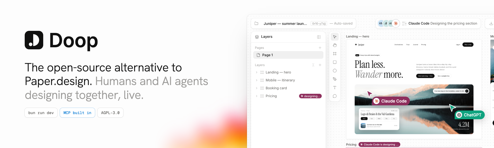
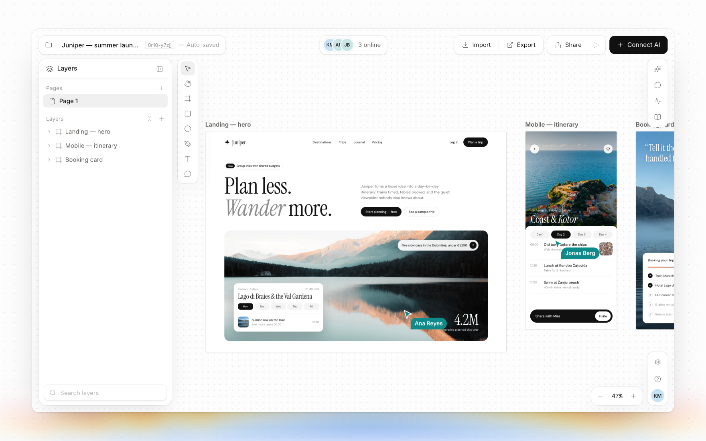
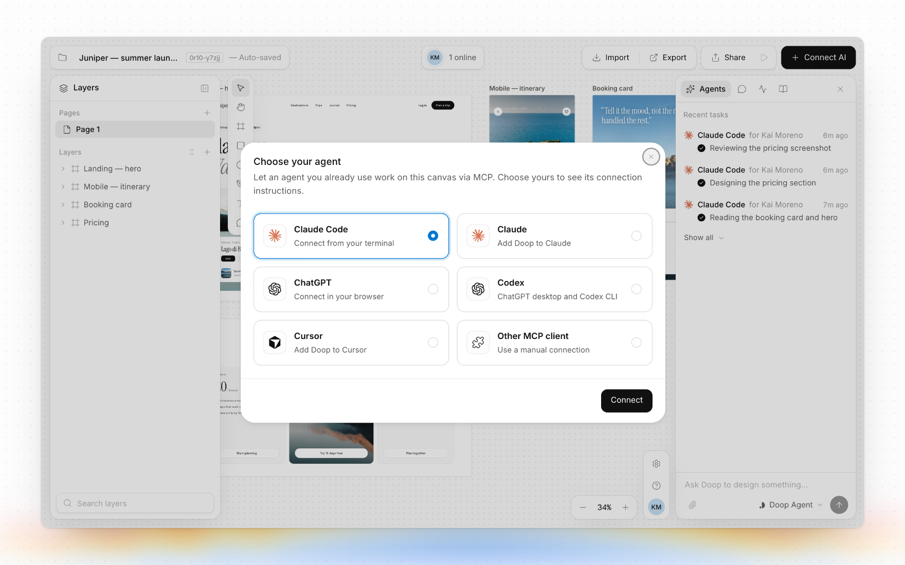
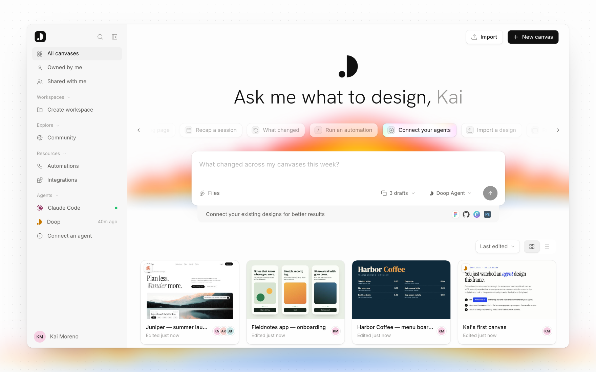
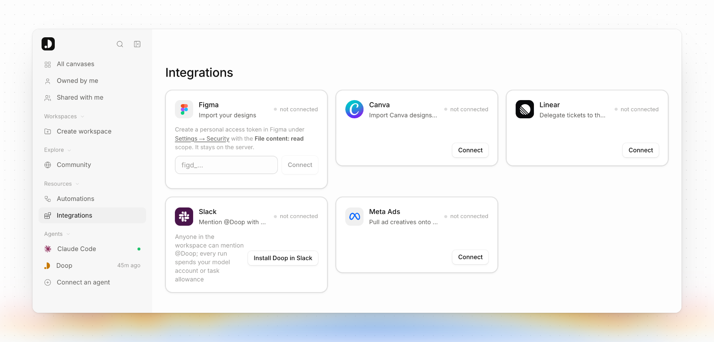
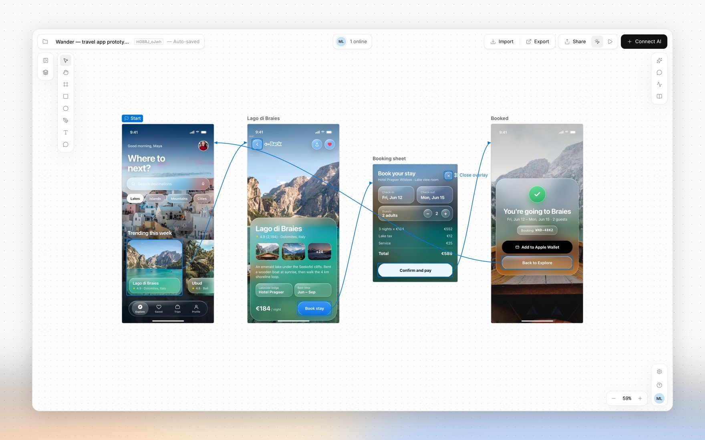
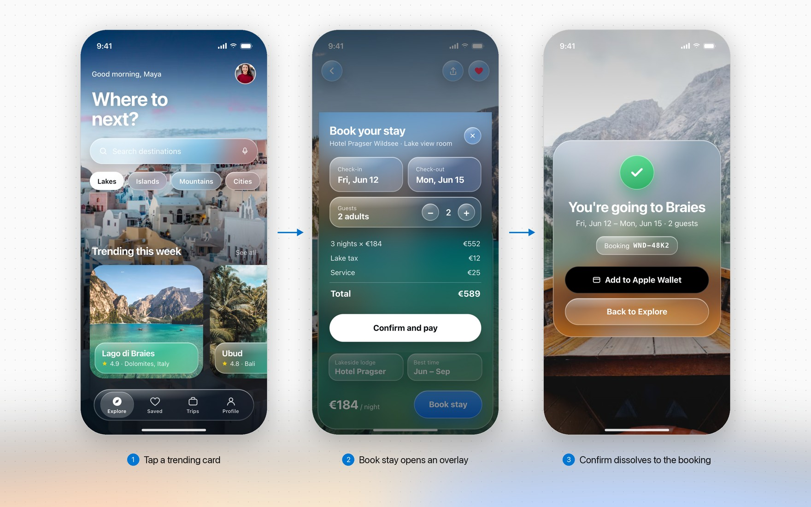
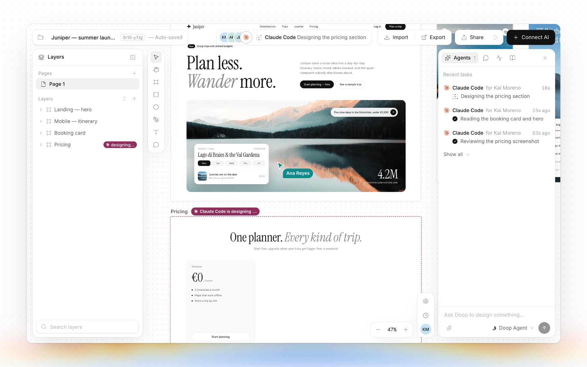
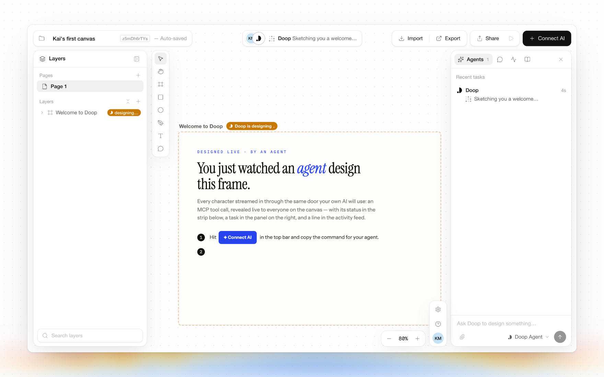
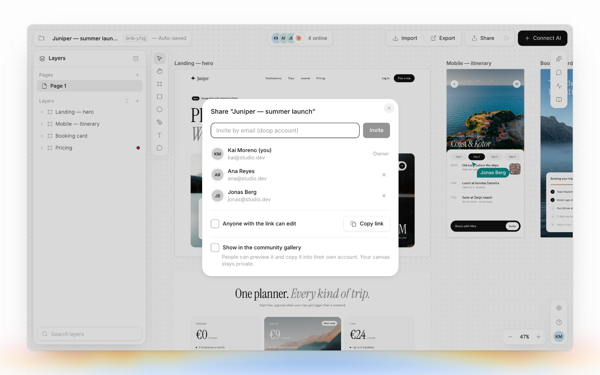

<p align="center">
  
</p>

<p align="center">
  <a href="https://github.com/kgoedecke/doop/actions/workflows/ci.yml"></a>
  <a href="LICENSE"></a>
  <a href="https://doop.design"></a>
  <a href="CONTRIBUTING.md"></a>
  <a href="https://discord.com/invite/3AUfXjgVe"></a>
</p>

<p align="center"><a href="README.md">English</a> · <b>Deutsch</b></p>

> Übersetzung der englischen README. Bei Abweichungen gilt die englische Fassung.

**[Doop](https://doop.design/?utm_source=github) ist die Open-Source-Alternative zu
[Paper.design](https://paper.design): ein gemeinsames Design-Canvas für Menschen _und_ KI-Agenten.**
Jedes Design liegt auf einem teilbaren **Canvas** (`/c/<id>`) mit **Frames**. Das sind
Zeichenflächen, die echtes HTML in isolierten iframes rendern. Menschen bearbeiten sie im Browser,
KI-Agenten tun das über den eingebauten **MCP-Server** und streamen ihre Designs live. Alle sehen in
Echtzeit Cursor, Anwesenheit, Frame-Bearbeitungen, Agentenstatus und einen Aktivitätsfeed.

Du kannst es dir wie Claude Design vorstellen, aber für den Agenten, den du bereits nutzt: **Claude
Code, Codex, ChatGPT, Cursor, OpenCode** oder jeder andere MCP-Client gestaltet auf demselben
Canvas. Der eingebaute Doop Agent nutzt Modelle von **GPT, Claude, Gemini, DeepSeek, Kimi oder
Qwen** ([alle Agenten und Modelle](#funktioniert-mit-jedem-agenten)).

<p align="center">
  
</p>

- **Mit Agenten designen statt Prompts eingeben und neu laden.** Verbinde Claude Code oder einen
  anderen MCP-Client einmal und sieh zu, wie er neben deinem Cursor Designs auf deinem Canvas
  skizziert, streamt und selbst prüft.
- **Ein eingebauter Doop Agent.** Stelle eine Karte in die Warteschlange oder erwähne eine Rolle mit
  @. Der Agent gestaltet selbstständig, ohne dass du einen Client verbinden musst. Er nutzt das
  Modellkonto, das jeder Nutzer verbindet (ein **ChatGPT-Abo** oder einen OpenAI-, Claude-, Gemini-,
  DeepSeek-, Kimi- oder OpenRouter-Key), oder den `ANTHROPIC_API_KEY` des Servers für so viele
  Gratis-Aufgaben, wie `RESIDENT_TASK_LIMIT` erlaubt (standardmäßig keine)
  ([Einrichtung](#der-doop-agent)). Die Willkommensvorführung auf dem ersten Canvas folgt einem
  Skript und braucht keines davon.
- **Seiten innerhalb eines Canvas.** Organisiere Frames über das Layers-Panel auf benannten Seiten.
  Du kannst Seiten hinzufügen, umbenennen (auch per Doppelklick) und per Drag-and-drop sortieren.
  Ein Rechtsklick öffnet Seitenaktionen, darunter das Kopieren eines Links, ohne die offene Seite zu
  wechseln. Seitenänderungen lassen sich rückgängig machen und wiederholen; ausgewählte Frames
  lassen sich zwischen Seiten verschieben. Agenten können Seiten mit `get_canvas` auflisten, mit
  `set_canvas_pages` verwalten (dabei schützt die ursprüngliche Liste als `expectedPages` die Arbeit
  anderer) und Frames mit `pageId` ansprechen. Wie in Figma kann jede Seite eine eigene Canvas-Farbe
  haben. Wenn nichts ausgewählt ist, öffnet das Schieberegler-Symbol rechts das Page-Panel mit dem
  Farbfeld Background (für Agenten: `set_page_background`). Wird die Farbe entfernt, zeigt die Seite
  wieder den Standardhintergrund des Themes.
- **Klickbare Prototypen.** Verbinde Elemente im Prototype-Modus oder direkt im HTML mit anderen
  Frames (Klick, Hover, Drücken, Taste oder Verzögerung; Navigation, Overlay, zurück, scrollen oder
  Link, jeweils mit Übergängen). Klicke dich dann mit Play durch den Ablauf oder teile
  `/c/<id>/proto`. Agenten verwenden dieselben `data-doop-*`-Attribute sowie `get_prototype` /
  `set_prototype_start`.
- **Ein richtiger Canvas-Editor.** Zeichne Frames, Formen, Zeichenstiftpfade und Text, bearbeite
  Füllung, Schrift und Flex-Layout jedes Elements, richte Elemente an Linealen und Hilfslinien aus
  und zoome von 8 % bis 1600 % ([der Editor](#der-canvas-editor)).
- **Gemeinsames Arbeiten in Echtzeit.** Live-Cursor, Anwesenheit, Follow-Modus, Bearbeitungsanzeigen
  pro Frame, Rückgängig/Wiederholen, Kommentarverläufe an Elementen oder am Canvas und ein
  Aktivitätsfeed laufen über einen gemeinsamen WebSocket-Raum.
- **Design-Gedächtnis.** Hefte beispielhafte Frames an, halte Entscheidungen fest und lass den
  Distiller dauerhafte Stilregeln vorschlagen, denen alle Agenten folgen.
- **Standardmäßig privat.** Lade Mitwirkende per E-Mail ein oder teile einen Link zum Anzeigen,
  Kommentieren oder Bearbeiten. Agenten erhalten genau die Rechte der Person, die sie verbunden hat.
- **Mit einem Befehl selbst hosten.** `docker compose up` oder `bun run dev` ohne Konfiguration
  (eingebettetes Postgres, keine externen Dienste erforderlich).

## Funktioniert mit jedem Agenten

Doop ist nicht an einen Modellanbieter gebunden. Alle Agenten in der Tabelle unten gestalten über
denselben MCP-Server und handeln im Namen der Person, die sie verbunden hat. Jeder erscheint mit
eigenem Cursor, eigenem Status und eigenen Aufgaben live auf dem Canvas. **Connect AI** in der
oberen Leiste führt dich durch die Einrichtung.

<p align="center">
  
</p>

| Agent                                           | Verbindung                                                                                        |
| ----------------------------------------------- | ------------------------------------------------------------------------------------------------- |
| Claude Code                                     | `claude mcp add`, OAuth im Browser ([Einrichtung](#claude-code-anbinden))                         |
| Claude (Web und Desktop)                        | **Add to Claude** in Connect AI ([Einrichtung](#claude-verbinden))                                |
| Codex (CLI und Desktop)                         | `codex mcp add`, OAuth im Browser ([Einrichtung](#einen-ki-agenten-verbinden))                    |
| ChatGPT                                         | Ein eigener MCP-Server in ChatGPT, Anleitung unter **Connect AI → ChatGPT**                       |
| Cursor                                          | **Add to Cursor** in Connect AI                                                                   |
| OpenCode, VS Code Copilot, OpenClaw und weitere | Jeder MCP-Client über OAuth oder mit einem Agent-Key ([Einrichtung](#einen-ki-agenten-verbinden)) |
| Headless-Agenten (n8n, Mastra, CI)              | Ein Agent-Key im `Authorization`-Header ([Einrichtung](#headless-agenten-agent-keys))             |

Kein eigener Agent? Der eingebaute [Doop Agent](#der-doop-agent) nutzt das Modellkonto, das du
verbindest: ein ChatGPT-Abo oder einen OpenAI-, Claude-, Gemini-, DeepSeek-, Kimi- oder
OpenRouter-Key. Über OpenRouter stehen Qwen, GLM, MiniMax und weitere Modelle bereit
([Details](#nach-den-gratis-aufgaben-eigenes-chatgpt-verbinden)).

## Schnellstart

```bash
git clone https://github.com/kgoedecke/doop && cd doop
bun install
bun run dev
```

Doop wird mit [bun](https://bun.sh) gebaut und installiert (`bun.lock` ist die einzige Lockdatei);
der Server selbst läuft auf Node.

- Web-App: **http://localhost:4300**
- API + WebSocket + MCP-Server: **http://localhost:4400** (der Web-Port leitet `/api`, `/ws`,
  `/mcp`, `/.well-known`, `/i/`, `/ingest` und `/local-agent` dorthin weiter)

`bun run dev` und `bun run build` packen auch die Claude-Desktop-Erweiterung mit einem Node-Skript,
deshalb muss Node ebenfalls in deinem `PATH` liegen.

Doop läuft ohne Konfiguration und speichert Daten in einem eingebetteten Postgres (PGlite) unter
`data/pg`. E-Mail-Versand, Stockfotos, Objektspeicher und Analytics lassen sich separat einrichten.
Ohne Objektspeicher speichert Doop Uploads lokal. Welche Variablen du für die einzelnen Integrationen
setzen musst, steht in [.env.example](.env.example)
([die wichtigen Variablen](#umgebungsvariablen)).

Der eingebaute [Doop Agent](#der-doop-agent) läuft, sobald ein Nutzer in Settings ein Modellkonto verbindet (oder
über den `ANTHROPIC_API_KEY` des Servers, wenn du `RESIDENT_TASK_LIMIT` erhöhst). Agenten, die du
selbst über MCP verbindest, brauchen keinen Key.

Du kannst den Produktionsbuild auch mit Docker selbst hosten:

```bash
BETTER_AUTH_SECRET=$(openssl rand -hex 32) docker compose up -d   # app + Postgres on :4400
```

Produktionsbuild ohne Docker: `bun run build && bun run start` (ein einzelner Server auf :4400
liefert alles aus). Setze `DATABASE_URL`, um einen separaten PostgreSQL-Server zu verwenden. Es nutzt denselben
Codepfad wie PGlite.

Du möchtest nichts selbst betreiben? **[doop.design](https://doop.design)** ist die gehostete
Version.

Nach der Anmeldung startest du auf Home: Beschreibe, was du möchtest, und Doop erstellt ein Canvas
mit Entwürfen in der Warteschlange für den Doop Agent. Oder mach mit einem deiner Canvases weiter.
Auch deine Workspaces und verbundenen Agenten findest du dort.

<p align="center">
  
</p>

## Der Canvas-Editor

Die Werkzeuge liegen in der unteren Leiste. Du kannst jedes mit einer einzelnen Taste aktivieren.
Formen, die du auf der freien Canvas-Fläche zeichnest, werden eigenständige Elemente. Zeichnest du
innerhalb eines Frames, wird die Form dort als positionierte HTML- oder SVG-Ebene eingefügt.
Agenten können den Quelltext dieser Ebenen lesen und bearbeiten.

| Tool        | Taste | Funktion                                                                                                               |
| ----------- | ----- | ---------------------------------------------------------------------------------------------------------------------- |
| Select      | V     | Klick wählt aus. Auf freier Fläche ziehen, um einen Auswahlrahmen aufzuziehen. ⇧/⌘-Klick erweitert die Auswahl.        |
| Hand        | H     | Ansicht verschieben (bei jedem Werkzeug mit gedrückter Leertaste oder mittlerer Maustaste)                             |
| Frame       | F     | Einen leeren Frame zeichnen                                                                                            |
| Rectangle   | R     | Ein Rechteck zeichnen                                                                                                  |
| Circle      | O     | Einen Kreis oder eine Ellipse zeichnen                                                                                 |
| Vector path | P     | Bézier-Stift mit Einrasten an eigenen Ankerpunkten und Vorschau beim Schließen des Pfads. Mit Alt rastet er nicht ein. |
| Text        | T     | Eine Textebene platzieren                                                                                              |
| Comment     | C     | Einen Kommentar an ein Element oder das Canvas heften                                                                  |

- **Frames.** Ziehe einen Frame, um ihn zu verschieben, oder an seinem Eckgriff, um die Größe zu
  ändern. Er rastet dabei an benachbarten Frames und Hilfslinien ein. Im Inspector bearbeitest du
  Name, Position, Größe und das rohe HTML, markierst den Frame als bereit für die Entwicklung,
  exportierst ihn und heftest ihn als Stilreferenz an. Unter **Version history…** im Frame-Menü kannst du frühere
  Designs in einer Vorschau ansehen und wiederherstellen.
- **Elemente innerhalb eines Frames.** Klicke ein Element an, um es auszuwählen. Ziehe an einem
  Eckgriff oder Rand, um die Größe zu ändern (⇧ hält das Seitenverhältnis, ein `W × H`-Badge zeigt
  die Größe), oder ziehe das Element selbst, um es innerhalb eines Frames oder in einen anderen zu
  verschieben. Im Tab **Design** bearbeitest du Füllung, Kontur, Text (Schrift, Größe, Schriftstärke,
  Ausrichtung), Deckkraft, Eckenradius, Drehung, Position, Flex-Layout (Richtung, Abstand,
  Innenabstand, Umbruch, Ausrichtung) und Bildfüllungen. **HTML** zeigt den Quelltext. Unter **Prototype** richtest du
  Interaktionen ein. Die schwebende Werkzeugleiste bietet **Comment**, **Ask AI** (fügt vorab eine
  `@mention` ein), **Code**, **Edit text** und **Copy link**.
- **Formatierter Text.** Doppelklicke Text, um ihn zu bearbeiten. Wähle Wörter aus und nutze die
  Formatierungsleiste für Fett, Kursiv, Unterstreichen, Durchstreichen, Aufzählungen oder
  nummerierte Listen. ⌘/Ctrl+B, I und U schalten die Zeichenformatierung um; ⌘/Ctrl+⇧+7 oder 8
  schalten nummerierte Listen oder Aufzählungen um. Enter setzt eine Liste fort; Enter auf einem
  leeren Eintrag beendet sie. Ist eine Textebene auf dem Canvas ausgewählt, ändern ⌘/Ctrl+B, I, U
  und ⌘/Ctrl+⇧+X die gesamte Ebene und ⌘/Ctrl+⇧+7 oder 8 machen sie wie in Figma zu einer Liste. Esc
  beendet die Bearbeitung; die Formatierung wird mit dem Frame gespeichert und lässt sich rückgängig
  machen und wiederholen. Sind Wörter ausgewählt, ändern Schrift, Größe, Schriftstärke und Farbe im
  Design-Panel nur diesen Textabschnitt. Bei Auswahl der ganzen Ebene erscheint **Mixed**, wo sich
  die Abschnitte unterscheiden. Ein dort gesetzter Wert gilt für alle Abschnitte, wie in Figma.
- **Pfade bearbeiten.** Doppelklicke einen Pfad, um seine Ankerpunkte und Bézier-Griffe zu verschieben.
  Du kannst einen Punkt zum Eck- oder Kurvenpunkt machen oder ihn löschen. Mit Alt bewegst du einen
  Griff unabhängig vom anderen. ⇧ begrenzt seinen Winkel.
- **Layers.** Ein durchsuchbarer Baum aus Seiten, Frames und Elementen. Ziehe Einträge, um ihre Reihenfolge zu ändern
  oder sie einem anderen Eintrag unterzuordnen. Du kannst sie auch ausblenden, sperren oder einklappen. Per
  Rechtsklick auf ein Element erhältst du Kopieren, Einfügen, Duplizieren, Copy HTML, Copy selector
  und Copy link to element.
- **Lineale und Hilfslinien.** ⇧R blendet Lineale ein. Ziehe eine Hilfslinie vom Lineal auf den Canvas.
  Hilfslinien gehören zur jeweiligen Seite. Änderungen daran kannst du rückgängig machen. Objekte
  rasten ein, sobald sie höchstens acht Bildschirmpixel von einer Hilfslinie entfernt sind.
- **Zoom.** 8 % bis 1600 %. Das Mausrad verschiebt, ⌘/Ctrl + Mausrad oder eine Pinch-Geste zoomt; ab
  300 % erscheint ein Raster im Abstand von einem Pixel. Das Zoom-Menü bietet 50/100/200-%-Vorgaben und
  den Linealschalter.
- **Panels.** Das rechte Seitenpanel enthält die Tabs **Agents**, **Comments**, **Activity** und
  **Memory**; Layers und das Seitenpanel lassen sich in der Größe ändern. Ziehe die Trennlinie
  zwischen Pages und Layers, um ihre Aufteilung zu ändern. Die Pfeiltasten verschieben die Trennlinie schrittweise.
  **Home** und **End** setzen sie an die jeweilige Endposition. Doop merkt sich die Aufteilung pro Canvas. Pages startet kompakt,
  bis du die Größe änderst. ⌘. blendet die gesamte Oberfläche aus.
- **Themes.** Light, Dark oder System unter Settings → Appearance.
- **Smartphones.** Das Canvas funktioniert auf dem Handy: mit einem Finger verschieben, per Pinch
  zoomen, zum Kommentieren tippen und Canvas-Aktionen, **Layers** oder den Inspector in Bedienfeldern öffnen, die vom unteren
  Bildschirmrand eingeblendet werden.

| Tastenkürzel       | Aktion                                                             |
| ------------------ | ------------------------------------------------------------------ |
| ⌘Z / ⌘⇧Z (oder ⌘Y) | Eigene Änderungen rückgängig machen / wiederholen                  |
| ⌘C / ⌘V / ⌘D       | Frames oder Ebenen kopieren, einfügen, duplizieren                 |
| ⌫                  | Das ausgewählte Element oder sonst die ausgewählten Frames löschen |
| ⌘⇧H / ⌘⇧L          | Auswahl ausblenden / sperren                                       |
| ⌥↑ / ⌥↓            | Eine Ebene nach oben oder unten verschieben (Layers-Panel)         |
| ⇧1 / ⇧2            | Ansicht auf alles bzw. auf die Auswahl zoomen                      |
| ⌘0 / ⌘+ / ⌘−       | Auf 100 % zoomen, vergrößern, verkleinern                          |
| ⇧R                 | Lineale ein- oder ausblenden                                       |
| ⌘.                 | Gesamte Oberfläche ein- oder ausblenden                            |
| ⌘⌥↩                | Ab dem ausgewählten Frame präsentieren (anderswo Ctrl+Alt+↩)       |
| ⌘K                 | Agents-Eingabe öffnen (auf Home: die Suchpalette)                  |
| Esc                | Auswahl aufheben, Folgen beenden                                   |

Klicke auf den Avatar eines Mitwirkenden, um dessen Ansicht zu folgen. Der Avatar eines Agenten
bringt dich zu dem Bereich, an dem er arbeitet. Platzhalter-Frames zeigen, wo ein Agent, der eine
Karte übernommen hat, als Nächstes gestaltet.

## Kommentare, Importe und Exporte

Kommentiere jedes Element oder eine beliebige Stelle auf dem Canvas. Der Tab **Comments** listet die
Kommentarverläufe der Seite (offen oder erledigt) samt Antworten auf. Erwähne eine Agentenrolle mit
`@mention` in einem Kommentar oder einer Antwort (zum Beispiel `@doop`), um eine Designkarte in die
Warteschlange zu stellen. Die Antwort des Agenten erscheint im Verlauf. Wer einen Kommentar
verpasst, erhält eine E-Mail-Zusammenfassung (abstellbar unter Settings → Account).

Doop zeigt dir einen Hinweis, wenn du ein Canvas über einen Ansichts- oder Kommentarlink öffnest.
Über beide Links kannst du das Design ansehen. Über den Kommentarlink kannst du auch kommentieren.
Zum Bearbeiten brauchst du eine entsprechende Freigabe.

Beim Import wählst du als Quelle **Website** (eine Seite oder eine ganze Website erkunden und Seiten
auswählen), **Live app** (das
[Sync-Snippet](#design-sync-live-screens-einer-app-auf-ein-canvas-übertragen)) oder **GitHub repo**
(über die GitHub App oder ein GitHub-Token mit gezielt vergebenen Berechtigungen). Bei einem
GitHub-Import prüft Doop die Screens und Komponenten des Repos und stellt Karten für den Doop Agent in die Warteschlange, damit
er sie skizziert und das Designsystem in einen Styleguide überträgt.

Klicke mit rechts auf einen Frame und wähle **Export…**, um PNG, JPG oder ein Vektor-PDF
herunterzuladen (für den Frame oder alle ausgewählten Frames als ein PDF). **Export** in der oberen Leiste fasst beliebige Frames der Seite in einem PDF
zusammen. Eine Fortschrittsanzeige zeigt, wie weit das Rendern ist; die Desktop-App öffnet ihren
nativen Speicherdialog. Jeder Frame hat auch ein öffentliches Live-Bild unter
`/i/<frameId>.png?scale=2` (oder `.jpg`), das bei Designänderungen neu gerendert wird, praktisch als
`og:image` oder in Dokumentationen.

Der Import und Export für Figma, Canva und Photoshop (PSD) ist derzeit in
[Doop Cloud](https://doop.design) verfügbar und nicht Teil der Open-Source-Version.

## Integrationen

Unter **Integrations** in der Seitenleiste verbindest du die externen Tools, mit denen Doop
arbeitet:

| Integration | Funktion                                                                                                                                                |
| ----------- | ------------------------------------------------------------------------------------------------------------------------------------------------------- |
| Linear      | Lies Issues über MCP oder delegiere ein Issue an Doop: Es gestaltet ein Canvas und meldet das Ergebnis an Linear zurück ([Einrichtung](docs/linear.md)) |
| Slack       | Erwähne `@Doop` mit einem Briefing; es gestaltet ein Canvas und veröffentlicht das Ergebnis im Thread ([Einrichtung](docs/slack.md))                    |
| Meta Ads    | Lade Werbemittel nach Zeitplan über eine [Automation](#automationen) auf ein Canvas                                                                     |

Die Figma-Integration (Frames als bearbeitbares HTML importieren und zurück nach Figma exportieren)
und die Canva-Integration (Designs als bearbeitbare Frames importieren und Frames mit editierbarem
Text zurücksenden) sind derzeit in [Doop Cloud](https://doop.design) verfügbar und nicht Teil der
Open-Source-Version. Auf einer selbst gehosteten Instanz zeigt die Integrations-Seite Linear, Slack
und Meta Ads.

<p align="center">
  
</p>

**Ausgehende Webhooks** (Settings → Webhooks) senden ein signiertes JSON-Ereignis per POST an deine
URL, wenn jemand einen Kommentar erstellt, beantwortet oder als erledigt markiert. Sie melden auch neue
Frames sowie abgeschlossene oder fehlgeschlagene Board-Karten eines Agenten. Doop versucht
fehlgeschlagene Zustellungen erneut. Du kannst die Verbindung mit einem Test-Ping prüfen ([Ereignisse und Signaturen](docs/webhooks.md)).

Um in Feedback auf ein bestimmtes Element zu verweisen, wähle es aus und klicke in seiner
schwebenden Werkzeugleiste auf **Copy link** oder klicke mit rechts auf seine Zeile in Layers und
wähle **Copy link to element**. Der Link öffnet die richtige Seite, wählt das Element aus und zeigt
seine Eigenschaften. Die URL enthält die Canvas-ID, die Frame-ID und im Parameter `selector` den
URL-kodierten CSS-Selektor. Damit findet ein KI-Agent das Element im HTML des Frames. Die
Zugriffsregeln des Canvas gelten weiterhin. Selektoren mit Element-IDs überstehen Layoutänderungen.
Selektoren, die ein Element anhand seiner Position innerhalb des Elternelements finden, können sich
ändern, wenn das HTML umstrukturiert wird.

## Screens für die Entwicklung freigeben

Wähle einen Frame aus und schalte im Inspector **Development → Mark as approved** ein, oder klicke
einen oder mehrere Frames mit der rechten Maustaste an und wähle **Mark ready for dev**. Über dem
Screen und im Layers-Panel erscheint ein grünes Badge. Fahre mit der Maus über die Toggle-Zeile oder
ein Badge, um zu sehen, wer die Freigabe wann erteilt hat. Schalte den Toggle aus, um einen
freigegebenen Screen zurück in den Entwurf zu setzen.

Wenn du das HTML oder die Maße des Frames änderst, wechselt ein freigegebener Screen zu **Needs
review**. Prüfe ihn und schalte **Mark as approved** wieder ein. Verschieben, Umbenennen,
Ausblenden, Sperren und der Wechsel auf eine andere Seite ändern nichts an der Freigabe. Kopien
starten als Entwurf. Die Freigabe prüft die Revision des Frames, damit eine gleichzeitige Änderung
nicht versehentlich freigegeben wird, und wartet, bis laufende Design-Streams beendet sind.

Agenten lesen `approvalStatus` (`draft`, `ready_for_dev`, `needs_review`) und die Zuordnung
`approval` in `get_canvas` und `get_frame`. Mit
`get_canvas({ canvas_id, approval_status: "ready_for_dev" })` findest du freigegebene Screens. Lies
danach `get_frame` noch einmal, bevor du umsetzt. Nur `ready_for_dev` gilt als aktuelle Freigabe.
Freigaben setzen Personen in der App, oder ein Agent tut es, wenn eine Person ihn darum bittet:
`set_frame_approval({ frame_id, status: "ready_for_dev" | "draft" })` (MCP und Doop Agent) trägt die
Freigabe auf den Namen dieser Person ein, der Agent steht als "via" daneben. Ein Agent gibt nie
ungefragt frei, und Automationsläufe können nicht freigeben. Wähle in **Automations** die Option
**Designs are approved**, um einen Workflow zu starten, sobald Frames auf einem ausgewählten Canvas
bereit für die Entwicklung sind. Ohne aktivierten Workflow hält die Freigabe nur die Abnahme fest.

Das REST-Pendant ist `PUT /api/frames/:id/approval` mit
`{ status: "ready_for_dev" | "draft", expectedUpdatedAt }`. Die Identität des angemeldeten Nutzers
liefert die Zuordnung. Der Endpunkt wendet dieselben Canvas-Zugriffsregeln an wie das Bearbeiten und
liefert `409`, wenn die geprüfte Revision veraltet ist.

## Klickbare Prototypen

Verwandle Frames in einen Ablauf, den du durchklicken kannst. Schalte den **Prototype mode** ein
(obere Leiste), wähle ein Element und füge im Tab **Prototype** eine Interaktion hinzu, oder ziehe
den Griff an seiner rechten Kante auf einen anderen Frame. Jede Interaktion besteht aus einem
Auslöser (Klick, Hover, Drücken, eine Taste oder eine Verzögerung) und einer Aktion (zu einem Frame
gehen, einen als Overlay öffnen, zurückgehen, das Overlay schließen, scrollen, einen Link öffnen),
optional mit einem Übergang: dissolve, slide oder push. Verbinder auf dem Canvas zeigen, wohin jedes
Element führt, und eine **Start**-Flagge markiert den Frame, mit dem der Ablauf jeder Seite beginnt.

<p align="center">
  
</p>

Drücke **Play**, um den Prototyp im Vollbild zu starten, oder teile `/c/<canvas-id>/proto`. Für den
Player gelten dieselben Zugriffsregeln wie für den Canvas. Mit den Browser-Schaltflächen **Zurück**
und **Vorwärts** wechselst du zwischen den Schritten. Frames bleiben beim Abspielen live, eine Änderung auf dem Canvas erscheint also auf
dem Screen, den du gerade ansiehst.

<p align="center">
  
</p>

Interaktionen sind einfache Attribute am Element im Frame-HTML. Sie werden deshalb zusammen mit dem
Frame synchronisiert, versioniert und exportiert, und Agenten schreiben sie mit denselben Tools, mit
denen sie designen:

```html
<button data-doop-on="click" data-doop-action="navigate:<frameId>" data-doop-transition="push-left">Book stay</button>
```

Agenten prüfen ihre Verknüpfungen mit `get_prototype`, das Links auf fehlende Frames meldet, und
legen den Start mit `set_prototype_start` fest. Diese Tools gibt es im MCP-Server und im eingebauten
Doop Agent. Die vollständige Attributreferenz steht in
[`.context/specs/prototyping.md`](.context/specs/prototyping.md).

## App für iPhone und iPad

Die iOS-App in SwiftUI liegt in [`ios/`](ios/README.md). Öffne `ios/Doop.xcodeproj` in Xcode, um sie
auszuführen und mit Doop Cloud oder deinem eigenen HTTPS-Server zu verbinden. Die App-Oberfläche
nutzt SwiftUI, dazu kommt ein natives Canvas, das Frames mit der HTML/CSS-Engine Blitz rendert
(Rust, kein WebKit). Die Verbindung läuft über dieselbe REST-API und dieselben WebSocket-Räume. Die
App ist in Entwicklung. Den Stand der Validierung und die offenen Release-Anforderungen findest du
in der iOS-README.

## Android-App

Die native Kotlin/Jetpack-Compose-App liegt in [`android/`](android/README.md). Öffne dieses
Verzeichnis in Android Studio oder führe darin `./gradlew assembleDebug` aus. Sie teilt sich den
Blitz/Skia-Renderer mit iOS und nutzt das bestehende REST/WebSocket-Backend. Sie bietet native
Canvas-Gesten, Bearbeitung, Agent-Prompts, Kommentare, Exporte und optionale Benachrichtigungen zu
Hintergrundaufgaben. Unterstützt werden ARM64-Smartphones und -Tablets ab Android 8. Setup, Tests
und das Signieren von Releases stehen in der Android-README.

## Claude verbinden

Wähle **Connect AI → Claude → Add to Claude**. Beim gehosteten Doop öffnet sich damit das
Connector-Formular von Claude, in dem Name und Server-URL von Doop bereits eingetragen sind.
Bestätige es, melde dich bei Doop an, starte dann einen neuen Claude-Chat und füge den Canvas-Prompt
aus dem Dialog ein. Du brauchst weder einen Dateidownload noch ein Terminal noch einen API-Key.

Die aktualisierte Doop-Desktop-App bietet **Add to Claude** auch für lokale und selbst gehostete
Server an. Sie öffnet direkt den Extension-Installer von Claude Desktop, in dem deine Server-URL
bereits eingetragen ist. Bestätige in Claude die Installation und anschließend die Anmeldung bei Doop. Der
Online-Connector braucht einen öffentlich erreichbaren HTTPS-Server, Verbindungen zu localhost
laufen über die Desktop-App. Die manuelle Installation der Extension bleibt als Ausweichlösung
möglich. Details zu Build und Installation: [`claude-extension/`](claude-extension/README.md).

## Claude Code anbinden

Ein Befehl verbindet Claude Code (oder einen beliebigen MCP-Client) mit deinem Canvas:

```bash
claude mcp add --transport http doop http://localhost:4300/mcp
```

Das startet den Standard-MCP-OAuth-Ablauf. Ein Browserfenster öffnet sich, du bestätigst, und ab
dann handelt der Agent **in deinem Namen**. Nenne ihm die ID deines Canvas, bitte ihn, etwas zu
designen, und sieh live zu. Der Screenshot zeigt den echten Ablauf: Claude Code hat sich mit
`set_status` gemeldet, einen Frame angelegt und erstellt darin live eine Preisübersicht. Zu sehen
sind der Avatar des Agenten, die Zuordnung "for Kai Moreno", die Markierung am Frame, die
Statusleiste und die Aufgabe im Agents-Panel.

<p align="center">
  
</p>

## Einem Agenten beim Designen zusehen

Auf dem ersten Canvas nach der Registrierung siehst du eine vorbereitete Demo. Das Willkommensdesign
erscheint Schritt für Schritt in einem Frame. Dessen Rand pulsiert, während die Statusleiste und das
Agents-Panel den Fortschritt anzeigen.

<p align="center">
  
</p>

Für die Demo (`server/demo.ts`) spielt Doop einen fertigen Frame über denselben
Mechanismus ab, den auch Agenten nutzen. Deshalb funktioniert die Vorführung ohne Konfiguration.
Für eigene Aufgaben braucht der Doop Agent Zugang zu einem Modell.

## Der Doop Agent

Doop bringt ein eingebautes Design-Team mit, das auf dem Server läuft und sich Arbeit selbst holt:
Stelle eine Board-Karte in die Warteschlange, erwähne eine Rolle per `@mention` in einem Kommentar
oder sende Feedback zu einer Aufgabe über die API. Das Team arbeitet dann ohne menschliches
Eingreifen. Die Rollen (Doop baut, Spezialisten übernehmen je einen Durchgang: UX, Copy, Brand,
Accessibility) sind in [`shared/agents.ts`](shared/agents.ts) definiert, und eine Karte lässt sich
der Reihe nach durch mehrere Rollen leiten.

Normalerweise werden die Aufgaben über das verbundene Modellkonto des jeweiligen Nutzers
abgerechnet. Für Gratis-Aufgaben kann der Server die Kosten übernehmen, standardmäßig über Anthropic.
Dafür muss `RESIDENT_TASK_LIMIT` größer als 0 sein:

```bash
ANTHROPIC_API_KEY=sk-ant-...   # in .env, or the environment of your deployment
```

Derselbe Key schaltet den **Guideline-Distiller** ([`server/distill.ts`](server/distill.ts)) frei,
der aus deinem Canvas dauerhafte Stilregeln vorschlägt.

Die Gratis-Stufe kann stattdessen auf **Azure OpenAI** laufen. Das lohnt sich, wenn die Credits oder
Compliance-Regeln deiner Organisation dort liegen:

```bash
DOOP_AGENT_PROVIDER=azure
AZURE_OPENAI_ENDPOINT=https://my-resource.openai.azure.com
AZURE_OPENAI_API_KEY=...
AZURE_OPENAI_DEPLOYMENT=my-deployment
```

Der Distiller bleibt in beiden Fällen auf `ANTHROPIC_API_KEY` und schaltet sich ohne ihn still ab.

### Nach den Gratis-Aufgaben: eigenes ChatGPT verbinden

Sind die Gratis-Aufgaben (`RESIDENT_TASK_LIMIT`) aufgebraucht, verlieren Nutzer den Agenten nicht.
Sie verbinden ein Modellkonto, und der Doop Agent läuft darauf weiter. **Ein verbundenes Konto
übernimmt ab der nächsten Aufgabe**, auch wenn noch Gratis-Aufgaben übrig sind. Ab der Verbindung
zahlt der Server nicht mehr für deine Aufgaben. Die Verbindung gilt für das ganze Konto und liegt deshalb unter **/settings**
(Home → Settings). Wenn die Gratis-Aufgaben aufgebraucht sind, zeigt Doop einen Link zu den Einstellungen.
**Connect an AI agent** auf dem Canvas führt zur Einrichtung von MCP-Clients. Für den Doop Agent gibt
es acht reguläre Verbindungsarten. Der Gemini-Cloud-Pilot und Claude Plan kommen hinzu, wenn der
Betreiber beziehungsweise die Desktop-App sie bereitstellt:

- **ChatGPT subscription.** OAuth-Anmeldung bei `auth.openai.com`, danach Inferenz über das
  Codex-Backend, das in den Tarifen Plus, Pro und Business enthalten ist. Die Tokens liegen in
  `model_accounts` und erreichen nie einen Browser.
- **OpenAI API key.** Abrechnung nach Verbrauch auf dem eigenen OpenAI-Konto des Nutzers, ganz ohne
  Abo.
- **OpenRouter API key.** Ein Key für eine kuratierte Auswahl mehrerer Anbieter: Kimi, Qwen, GLM,
  DeepSeek, MiniMax, MiMo und Gemini Flash (das Menü steht in
  [`shared/modelMenu.ts`](shared/modelMenu.ts)). Modelle ohne Bildeingabe funktionieren trotzdem,
  nur eingeschränkt: Der Agent prüft das Design anhand des Frame-HTML. Im Modellmenü steht bei
  diesen Modellen der Hinweis "no visual review".
- **Gemini API key.** Googles Gemini-Modelle über deren OpenAI-kompatiblen Endpunkt, dazu
  Bildgenerierung mit Nano Banana.
- **DeepSeek API key.** DeepSeek V4.1 Flash (mit Vision) und V4 Pro (vorerst nur Text) auf dem
  eigenen Konto des Nutzers bei platform.deepseek.com.
- **Kimi API key.** Moonshots Kimi-K3-Modelle, alle mit Vision, auf dem eigenen Konto des Nutzers
  bei platform.moonshot.ai. Für einen Key von Moonshots China-Plattform muss ein Betreiber
  `KIMI_CHAT_URL` auf `https://api.moonshot.cn/v1/chat/completions` setzen.
- **Kimi Code plan.** Eine Kimi-Mitgliedschaft (ab Plus) über einen Key aus der Kimi-Code-Konsole,
  abgerechnet über die Mitgliedschaft statt pro Token. Sie hat einen eigenen Endpunkt
  (`KIMI_CODE_CHAT_URL`, `api.kimi.ai/coding/v1` international) und eigene IDs (`k3.1-pro`,
  `k3.1-pro-highspeed`, `k3`). Anfragen nennen Doop in ihrem `User-Agent`, wie es die Bedingungen
  von Kimi Code von jedem Drittanbieter-Tool verlangen.
- **Gemini cloud pilot.** Ein vom Betreiber verwalteter Prototyp, der die offizielle Gemini CLI in
  einem isolierten Worker mit Google-Anmeldung ausführt. Standardmäßig deaktiviert, siehe die
  [Anleitung zu Einrichtung und Verifizierung des Piloten](docs/gemini-cloud-pilot.md).
- **Claude API key.** Abrechnung nach Verbrauch auf dem eigenen Anthropic-Konto des Nutzers.
- **Claude Plan (desktop app).** Die Doop-Desktop-App führt den Doop Agent über den eigenen lokalen
  Claude-Code-Login des Nutzers aus (`claude -p`), mit einem MCP-Token, das nur für einen Lauf gilt.
  Sobald der Claude Plan eingeschaltet ist, hat er Vorrang vor verbundenen Konten, solange die App
  online ist. Einrichtung: [`desktop/README.md`](desktop/README.md#local-claude-cli).

Bei den Kontoarten ChatGPT, OpenAI, Claude und Gemini kommt das Modellmenü aus dem Katalog des
Anbieters selbst. Er wird mit den Zugangsdaten des Kontos abgefragt, sobald der Picker sich öffnet
(`server/modelCatalog.ts`, `GET /api/model-account/models`). Das ist bei einem ChatGPT-Abo der
Katalog des Codex-Backends (dieselbe Liste, die die Codex CLI liest, mit
`CHATGPT_CODEX_CLIENT_VERSION` als Client-Version abgefragt), bei OpenAI und Anthropic `/v1/models`,
bei Gemini `/v1beta/models`. Ein neu veröffentlichtes Modell steht ohne Upgrade im Menü. Die oben
genannten kuratierten Einträge stehen als Empfehlungen ganz oben. Eine kuratierte Stufe, die das
Konto nicht ausführen kann, fällt weg. Ist der Anbieter nicht erreichbar, erscheint nur das
kuratierte Menü. OpenRouter, DeepSeek, Kimi und Kimi Code bleiben bei ihren kuratierten Listen,
in denen Doop für jedes Modell geprüft hat, ob es Bilder verarbeiten kann. DeepSeek und Kimi
liefern ihr Reasoning als `reasoning_content` zurück und lehnen eine Konversation mit Tool-Aufrufen ab, in der es fehlt.
Deshalb behält der Transport es im Verlauf des Laufs und schickt es in jeder Runde zurück.

Azure OpenAI ist bewusst _keine_ verbindbare Kontoart, und die
OpenRouter-/Gemini-/DeepSeek-/Kimi-Endpunkte sind feste Konstanten. Ein vom Nutzer angegebener
Endpunkt wäre eine URL, die der Server mit dem vollen Kontext des Laufs abruft, und damit ein
SSRF-Einfallstor. Eigene Endpunkte bleiben deshalb reine Konfiguration auf Serverebene.

In jedem Fall wählen Nutzer ihre **Modellstufe** in Settings aus dem kuratierten Menü des jeweiligen
Anbieters. Bei OpenAI sind das `gpt-6-astra` (das neueste Flaggschiff; bei einem ChatGPT-Abo braucht
es Plus oder höher, und OpenAI führt es noch Konto für Konto ein), `gpt-5.6-sol` (Flaggschiff),
`gpt-5.6-terra` (das Standardmodell) oder `gpt-5.6-luna` (günstig und schnell). Sie bezahlen
dafür, deshalb entscheiden sie selbst. `DOOP_AGENT_OPENAI_MODEL`, `DOOP_AGENT_OPENROUTER_MODEL`,
`DOOP_AGENT_GEMINI_MODEL`, `DOOP_AGENT_DEEPSEEK_MODEL`, `DOOP_AGENT_KIMI_MODEL` und
`DOOP_AGENT_KIMI_CODE_MODEL` legen nur den Standard fest, mit dem sie starten. Beachte: `gpt-5.4`
und `gpt-5.4-mini` laufen in Codex mit ChatGPT-Anmeldung am **31. August 2026** aus. Wer über eine
dieser Variablen eine 5.4-ID festschreibt, kann den Abo-Pfad danach nicht mehr nutzen.

OpenAI registriert für eine gehostete App keine Redirect-URI. Deshalb läuft die Verbindung zu
ChatGPT in einer von drei Varianten, und Doop wählt die aufwandsärmste verfügbare:

| Wo Doop läuft                                                | Ablauf                                          | Was der Nutzer tut                                                                      |
| ------------------------------------------------------------ | ----------------------------------------------- | --------------------------------------------------------------------------------------- |
| Gleicher Rechner wie der Browser (Entwicklung, Self-Hosting) | Lokale Rückleitung an Doop auf `127.0.0.1:1455` | Im OpenAI-Tab bestätigen. Nichts zu kopieren, keine Einrichtung                         |
| Gehostet (doop.design)                                       | Device Code (`/api/accounts/deviceauth/*`)      | Einen kurzen Code auf `auth.openai.com/codex/device` eingeben                           |
| Device Codes nicht erlaubt                                   | Browser-Redirect + Einfügen                     | Die vollständige Adresse der nicht erreichbaren `localhost:1455`-Seite in Doop einfügen |

Der Device-Flow braucht eine eingeschaltete **device code authorization** unter ChatGPT → Settings →
Security (Workspace-Mitglieder brauchen dafür einen Admin, der die Einstellung erlaubt). Deshalb
bleibt der Loopback-Ablauf, der gar keine Einstellung braucht, der Standard, wenn Doop lokal läuft.
Alle drei enden im selben PKCE-Austausch auf dem Server.

> **Bevor du das für echte Nutzer einschaltest:** Ein ChatGPT-Abo von einem Drittanbieter-Server aus
> zu nutzen, ist von den Bedingungen von OpenAI nicht gedeckt, und starke Nutzung kann dazu führen,
> dass ein Konto gedrosselt oder gesperrt wird. Der API-Key-Pfad ist die voll unterstützte
> Alternative und nutzt denselben Code. `CHATGPT_CONNECT_DISABLED=1` schaltet den Abo-Pfad ab und
> lässt den Key-Pfad bestehen.

Läufe werden dem Menschen zugeordnet, dessen Karte, Kommentar oder Feedback sie aufgegriffen haben.
Die Arbeit läuft also über das Konto der Person, die sie angefordert hat. Die Übersetzung zwischen
der Agent-Schleife im Anthropic-Format und OpenAIs Responses API liegt in
[`server/openaiAgent.ts`](server/openaiAgent.ts). Welche Zugangsdaten ein Lauf bekommt, entscheidet
[`server/agentModel.ts`](server/agentModel.ts).

**Ohne Server-Key und ohne verbundenes Konto** ist der Doop Agent aus, ohne Fehlermeldung und mit
Absicht: Karten in der Warteschlange und `@mentions` warten einfach, bis irgendein Agent sie
übernimmt. Das Startbanner zeigt dir, in welchem Zustand du bist.

**Das alles hat nichts damit zu tun, einen eigenen Agenten zu verbinden.** Claude Code und jeder
andere MCP-Client melden sich per OAuth an und steuern das Canvas von außen, über dein eigenes Abo.
Sie werden nie auf den Zähler angerechnet. Es gibt also drei Wege auf dasselbe Canvas: der Doop
Agent mit unserem Key (Gratis-Stufe), der Doop Agent mit deinem Key oder dein eigener Agent über
MCP.

| Variable                        | Standard                    | Funktion                                                                                                  |
| ------------------------------- | --------------------------- | --------------------------------------------------------------------------------------------------------- |
| `DOOP_AGENT_PROVIDER`           | `anthropic`                 | Worauf die Gratis-Stufe läuft: `anthropic` \| `azure`                                                     |
| `ANTHROPIC_API_KEY`             | _nicht gesetzt_             | Bezahlt die Gratis-Stufe des Doop Agent (Standardanbieter) und den Distiller                              |
| `AZURE_OPENAI_ENDPOINT`         | _nicht gesetzt_             | Die Azure-OpenAI-Ressource der Gratis-Stufe, bei `DOOP_AGENT_PROVIDER=azure`                              |
| `AZURE_OPENAI_API_KEY`          | _nicht gesetzt_             | Ein Key dieser Ressource                                                                                  |
| `AZURE_OPENAI_DEPLOYMENT`       | _nicht gesetzt_             | Das Deployment, auf dem die Gratis-Stufe läuft                                                            |
| `AZURE_OPENAI_API_VERSION`      | _nicht gesetzt_             | Legt einen Query-Parameter `api-version` fest; die v1-Schnittstelle braucht keinen                        |
| `AZURE_OPENAI_REASONING_EFFORT` | _nicht gesetzt_             | Reasoning-Aufwand bei Azure-Läufen; ohne Wert wird keiner gesendet (sicher für Modelle ohne Reasoning)    |
| `RESIDENT_TASK_LIMIT`           | `0`                         | Gratis-Aufgaben des Doop Agent pro Konto; `0` heißt: ab der ersten Aufgabe ein verbundenes Konto          |
| `DOOP_AGENT_MODEL`              | `claude-opus-5`             | Modell für den Doop Agent mit dem Anthropic-Key des Servers                                               |
| `DOOP_AGENT_OPENAI_MODEL`       | `gpt-5.6-terra`             | Standardstufe auf dem Konto eines Nutzers; jeder Nutzer kann in Settings eine andere wählen               |
| `DOOP_AGENT_OPENAI_EFFORT`      | `medium`                    | Standard-Reasoning-Aufwand auf dem OpenAI-Konto eines Nutzers; jeder Nutzer kann von low bis xhigh wählen |
| `DOOP_AGENT_OPENROUTER_MODEL`   | `moonshotai/kimi-k2.6`      | Standardmodell bei einem verbundenen OpenRouter-Key                                                       |
| `DOOP_AGENT_GEMINI_MODEL`       | `gemini-3.7-flash`          | Standardmodell bei einem verbundenen Gemini-Key                                                           |
| `DOOP_AGENT_DEEPSEEK_MODEL`     | `deepseek-flash`            | Standardmodell bei einem verbundenen DeepSeek-Key                                                         |
| `DOOP_AGENT_KIMI_MODEL`         | `kimi-k3.1-pro`             | Standardmodell bei einem verbundenen Kimi-Key                                                             |
| `DOOP_AGENT_KIMI_CODE_MODEL`    | `k3.1-pro`                  | Standardmodell bei einem verbundenen Kimi-Code-Plan                                                       |
| `CHATGPT_CONNECT_DISABLED`      | _nicht gesetzt_             | `1` blendet den ChatGPT-Ablauf aus und lässt den API-Key-Pfad bestehen                                    |
| `DOOP_DISTILL_MODEL`            | `claude-haiku-4-5-20251001` | Modell für den Guideline-Distiller                                                                        |

`RESIDENT_TASK_LIMIT` ist der Zähler der Gratis-Stufe. Standardmäßig steht er auf `0`: Der Doop
Agent kann erst arbeiten, sobald der Nutzer ein Modellkonto verbindet. Aufgaben auf einem
verbundenen Modellkonto zählen nicht zum Gratislimit. Ein eigener MCP-Agent gestaltet mit deinem
Modell. Das Gratislimit für den eingebauten Doop Agent bleibt dabei bestehen. Seine Aufgaben werden
weiterhin über die jeweils verwendeten Zugangsdaten abgerechnet. Setze das Limit auf einen Wert
über 0, um entsprechend viele Gratis-Aufgaben über den Server-Key zu ermöglichen. Feedback und
Wiederholungen zählen ebenfalls, wenn dadurch eine Aufgabe für den Doop Agent entsteht. Es gibt keinen Wert "unlimited": Wenn du mit eigenem Key selbst hostest, setze
es auf eine große Zahl, da du Anthropic ohnehin direkt bezahlst.

## Konten

Für die Web-App brauchst du ein Konto (better-auth, E-Mail und Passwort, offene Registrierung). Dein
Kontoname ist überall deine Identität. Für Cursor, Anwesenheit, Aktivitätsfeed und die Zuordnung von
Feedback liest der Server ihn aus der Sitzung. Der WebSocket lehnt nicht angemeldete Verbindungen
ab. **Canvases sind standardmäßig privat**, wie bei Figma: Nur der Eigentümer und eingeladene
Personen können sie öffnen (Share → Einladung per E-Mail an bestehende Doop-Konten). Im Share-Dialog
legt der Eigentümer auch fest, was Personen mit dem Link dürfen: keinen Zugriff (standardmäßig nur
mit Einladung), **view**, **comment** oder **edit**. Im selben Dialog kann der Eigentümer das Canvas
einem Workspace zuordnen oder in der **Community**-Galerie (`/community`) veröffentlichen. Dort
können angemeldete Personen veröffentlichte Canvases ansehen und eigene Kopien davon erstellen.
Auf Home stehen deine eigenen Canvases und die mit dir geteilten sowie ältere Canvases ohne Eigentümer, die
du dort übernehmen kannst. Über MCP verbundene Agenten handeln im Namen des Kontos, das sie
freigegeben hat, und haben genau dessen Zugriff.

<p align="center">
  
</p>

Wenn SMTP konfiguriert ist (`SMTP_HOST` usw., siehe [.env.example](.env.example)), müssen neue
Konten ihre E-Mail-Adresse bestätigen. "Passwort vergessen" verschickt echte Links zum Zurücksetzen.
Ohne SMTP bleibt die Registrierung offen und jede E-Mail wird samt Links im Serverlog ausgegeben.
Die Abläufe funktionieren damit auch in der Entwicklung.

Setze `SIGNUP_EMAIL_DOMAINS=jointhetroops.com`, um neue Konten auf eine E-Mail-Domain zu
beschränken. Für mehrere Domains nutze eine kommagetrennte Liste. Der Abgleich ignoriert Groß- und
Kleinschreibung und verlangt eine genaue Übereinstimmung. Bestehende Konten sind nicht betroffen.
Lass die Variable leer, damit die öffentliche Registrierung offen bleibt.

Setze `REQUIRE_EMAIL_VERIFICATION=false`, damit sich Personen schon vor der Bestätigung anmelden
können. Der Link wird weiterhin per E-Mail verschickt, die Anmeldung hängt aber nicht mehr davon ab.
Die Vergabe der Admin-Rolle ist davon bewusst ausgenommen: `ADMIN_EMAILS` befördert nur bestätigte
Adressen (siehe unten).

Wenn Registrierung oder Zurücksetzen des Passworts **hängt**, statt einen Fehler zu melden,
blockiert fast immer der Host ausgehendes SMTP: Railway und die meisten PaaS-Anbieter blockieren
25/465/587. Resend bietet auch 2465/2587 an, daher hilft meist `SMTP_PORT=2587`.

Umgebungsvariablen: `BETTER_AUTH_SECRET` (in Produktion erforderlich), `TRUSTED_ORIGINS`
(kommagetrennt, standardmäßig die Localhost-Entwicklungsadressen).

### Workspaces und Abrechnung (Team-Plan)

Ein **Workspace** ist der gemeinsame Bereich eines Teams für Canvases. Alle Mitglieder können jedes
Canvas darin öffnen, ohne für jedes einzeln eingeladen zu werden. Erstelle einen Workspace über die
Seitenleiste auf Home und lade Personen per E-Mail ein. Bestehende Konten treten sofort bei, alle
anderen bei der Registrierung mit dieser Adresse. Canvases kannst du über den Share-Dialog oder das
Canvas-Menü ("Move to workspace…") zuordnen. Personen, Rollen (owner / admin / member) und die
Abrechnung verwaltest du unter `/w/<id>`. Agenten sehen die Canvases eines Workspaces in
`list_canvases` und können über den Parameter `workspace_id` von `create_canvas` dort Canvases
erstellen.

Workspaces sind der kostenpflichtige Teil von Doop in einem gehosteten Deployment. Die Pläne stehen
in `shared/billing.ts`:

| Plan       | Preis                                                  | Inhalt                                                                                      |
| ---------- | ------------------------------------------------------ | ------------------------------------------------------------------------------------------- |
| Personal   | kostenlos                                              | Eigene Canvases, Einladungen pro Canvas, Agenten, Community, Importe.                       |
| Team       | $20 pro Person und Monat oder $192 pro Person und Jahr | Gemeinsame Workspaces mit Rollen. Die Abrechnung richtet sich nach der Zahl der Mitglieder. |
| Enterprise | Kontaktiere uns                                        | SSO, dedizierter Support, individuelle Konditionen.                                         |

**Self-Hosting: Die Abrechnung ist standardmäßig ausgeschaltet.** Ohne `STRIPE_SECRET_KEY` ist jeder
Workspace aktiv und nichts gesperrt. Ist der Key gesetzt, braucht ein Workspace ein aktives
Abonnement pro Platz, bevor er _wachsen_ kann, also bevor jemand darin Canvases erstellen, Personen
einladen oder Canvases aufnehmen kann. Bei jedem dieser Versuche erscheint der Upgrade-Dialog.
Bereits im Workspace vorhandene Canvases bleiben für dessen Mitglieder unabhängig vom Abonnement
zugänglich. Eine fehlgeschlagene Kartenzahlung sperrt ein Team also nicht von seiner Arbeit aus.
Wird ein Workspace gelöscht, gehen alle Canvases an die persönlichen Bereiche ihrer jeweiligen
Eigentümer zurück und das Abonnement wird gekündigt.

Um die Abrechnung einzuschalten, erstelle das Produkt und die Preise mit
`node scripts/stripe-setup.mjs`. Der Befehl gibt `STRIPE_PRICE_TEAM_MONTHLY` /
`STRIPE_PRICE_TEAM_YEARLY` aus. Richte einen Stripe-Webhook auf `<origin>/stripe/webhook` für
`checkout.session.completed` und `customer.subscription.{created,updated,deleted}` ein und setze
`STRIPE_WEBHOOK_SECRET`. Stripe stellt die Seiten für den Kaufabschluss, die Verwaltung von
Zahlungskarten, Rechnungen und Kündigungen bereit. Der Server synchronisiert nur den
Abonnementstatus des Workspaces. Das geschieht
über den Webhook und direkt, wenn der Browser vom Checkout zurückkehrt. So funktioniert die lokale
Entwicklung ohne Tunnel.

### Instanz-Admins

`ADMIN_EMAILS` enthält die Konten, die die Rolle `admin` erhalten, durch Kommas getrennt. Die Rolle
wird bei der Registrierung, bei der E-Mail-Verifizierung und beim Start zugewiesen. Du kannst also
einen Admin vor oder nach der Kontoerstellung festlegen. **In Produktion ist dafür SMTP
erforderlich**: Eine Adresse identifiziert erst dann eine Person, wenn diese nachgewiesen hat, dass
die Adresse ihr gehört. Ohne Mailer ist die Registrierung offen und jeder könnte sich mit deiner
Adresse registrieren und die Rolle erhalten. Eine Produktionsinstanz ohne SMTP befördert niemanden
zum Admin und gibt beim Start eine Warnung aus. Setze die Rolle bei dieser Konfiguration direkt in
der Datenbank.

Admins erhalten Zugriff auf `/admin` mit allen Canvases und Konten der Instanz sowie auf "view as".
Damit sehen sie die App 15 Minuten lang aus Sicht der jeweiligen Person. Die Sitzung ist
**schreibgeschützt**.
Die Admin-Rolle erweitert den Canvas-Zugriff selbst nicht: Die Zugriffskontrolle in
[`server/access.ts`](server/access.ts) gilt auch für MCP. Ein privilegierter Lesezugriff dort würde
jedem Agenten mit dem Token eines Admins Zugriff auf die gesamte Instanz geben. View-as-Sitzungen
können weder schreiben noch Agenten verbinden und halten in `session.impersonated_by` fest, wer
dahintersteht.

### SSO (OIDC)

Optionale Anmeldung über einen externen OIDC-Anbieter (Zitadel, Okta, Authentik, Keycloak usw.),
ergänzend zu E-Mail und Passwort. Sie ersetzt diese nicht. Setze `OIDC_ISSUER`, `OIDC_CLIENT_ID` und
`OIDC_CLIENT_SECRET` gemeinsam, um SSO zu aktivieren. Bei unvollständiger Konfiguration startet die
Instanz nicht. `OIDC_SCOPES` (Standard `openid email profile`) und `OIDC_PROVIDER_NAME` (Standard
`SSO`, auf dem Anmeldebutton angezeigt, z. B. `Zitadel`) sind optional. Bei der Anmeldung über SSO
wird ein bestehendes Konto mit E-Mail und Passwort verknüpft, wenn die E-Mail-Adressen
übereinstimmen und der Anbieter die Adresse als verifiziert markiert. Das funktioniert auch auf
einer Instanz ohne SMTP, auf der sich ein lokales Konto sonst nicht selbst verifizieren könnte. SSO
allein vergibt niemals die Admin-Rolle, auch nicht für eine in `ADMIN_EMAILS` aufgeführte Adresse.
Doop vertraut dem Identitätsanbieter nur bei der Bestätigung der E-Mail-Adresse. Doop vergibt die
Admin-Rolle selbst.
Dafür ist weiterhin der reguläre Weg über `ADMIN_EMAILS` nötig: eine verifizierte Registrierung oder
`syncAdmins` beim Start für ein inzwischen durch SSO verifiziertes Konto.

Umgebungsvariablen: siehe den OIDC-Block in [.env.example](.env.example).

### Anmelden mit Google

Optional, ergänzend zu E-Mail und Passwort sowie SSO. Erstelle einen OAuth-Client (Web application)
in der [Google Cloud console](https://console.cloud.google.com/apis/credentials), füge
`<BETTER_AUTH_URL>/api/auth/callback/google` als autorisierte Redirect-URI hinzu und setze
`GOOGLE_CLIENT_ID` und `GOOGLE_CLIENT_SECRET` zusammen. Ist nur eine der beiden Variablen gesetzt,
startet die Instanz nicht. Die Anmeldeseite zeigt einen "Sign in with Google"-Button, sobald beide
gesetzt sind. Für Kontoverknüpfung und Admin-Rolle gelten dieselben Regeln wie für SSO oben.
`SIGNUP_EMAIL_DOMAINS` gilt für Registrierungen über Google und SSO genauso wie für E-Mail und
Passwort.

### Anmelden mit Microsoft

Die Einrichtung entspricht der von Google. Registriere eine App in
[Microsoft Entra](https://entra.microsoft.com) (App registrations, Plattform Web) mit
`<BETTER_AUTH_URL>/api/auth/callback/microsoft` als Redirect-URI, erstelle ein Client-Secret und
setze `MICROSOFT_CLIENT_ID` und `MICROSOFT_CLIENT_SECRET` zusammen. `MICROSOFT_TENANT_ID` (Standard
`common`) bestimmt, welche Konten sich anmelden können. `common` erlaubt Privat-, Geschäfts- und
Schulkonten. `organizations` erlaubt nur Geschäfts- und Schulkonten, `consumers` nur private
Microsoft-Konten. Mit einer Tenant-ID beschränkst du den Zugang auf diesen Microsoft-Entra-Mandanten.
Microsoft bestätigt den Besitz der E-Mail-Adresse nur, wenn das ID-Token der App-Registrierung die optionalen Claims `email` und
`verified_primary_email` enthält. Ohne diese funktioniert die Anmeldung über Microsoft weiterhin,
wird aber nur mit einem bereits verifizierten Konto verknüpft. Für alles Weitere, etwa die
Zulassungsliste und die Admin-Rolle, gelten die SSO-Regeln oben.

### Anmelden mit Apple

Die Einrichtung besteht aus zwei unabhängigen Teilen, die in [.env.example](.env.example)
dokumentiert sind. Für den Web-Button registriere eine Services ID mit aktiviertem Sign in with
Apple und `<BETTER_AUTH_URL>/api/auth/callback/apple` als Return-URL. Setze anschließend
`APPLE_CLIENT_ID` (die Services ID) und `APPLE_CLIENT_SECRET` zusammen. Letzteres ist das mit deinem
Sign in with Apple Key signierte Client-Secret-JWT, dessen Laufzeit Apple auf sechs Monate begrenzt.
Setze für die iOS-App `APPLE_APP_BUNDLE_IDENTIFIER` auf die Bundle-ID der App. Die App zeigt den
nativen Sign in with Apple Button und sendet das von Apple für diese Bundle-ID ausgestellte
Identity-Token an `/api/auth/sign-in/social`. Der Server prüft es anhand der Keys von Apple. Apple
sendet den Namen der Person nur bei ihrer ersten Anmeldung, daher leitet die App ihn dann weiter.
Bei einer späteren Anmeldung nach einer Neuinstallation bleibt der gespeicherte Name erhalten. Für
Kontoverknüpfung und Admin-Rolle gelten die SSO-Regeln oben. Apples "Hide My Email"-Adressen gehören
zur Domain `privaterelay.appleid.com`. `SIGNUP_EMAIL_DOMAINS` lehnt sie ab, sofern die Domain nicht
aufgeführt ist.

## Agent-Anmeldung (MCP OAuth)

Der Endpunkt `/mcp` verlangt OAuth. Wenn du den Server in Claude Code / Codex hinzufügst, startet
der standardmäßige MCP-OAuth-Ablauf. Ein Browserfenster öffnet sich, du meldest dich bei Doop an und
stimmst zu. Der Client speichert ein Bearer-Token. Jeder Tool-Aufruf enthält danach deine Identität.
Agentenaufgaben zeigen im Agents-Panel "for ⟨you⟩" und die Tooltips zur Anwesenheit nennen den
Eigentümer. Nicht authentifizierte Aufrufe erhalten einen 401-Fehler. Dessen
`WWW-Authenticate`-Header verweist auf `/.well-known/oauth-protected-resource/mcp` und fordert
`openid profile email offline_access` an, damit Clients Refresh-Tokens erhalten. Das startet den
Ablauf. Die Zustimmungsseite liegt unter `/oauth/consent`. Dynamische Client-Registrierung ist
aktiviert, daher ist keine manuelle Client-Einrichtung nötig. `ping` und
`resources/list`/`resources/read` antworten ohne Token. Agenten eines gesperrten Kontos erhalten
auch mit gültigem Token einen 403-Fehler.

Der Endpunkt nimmt nur `POST` an und antwortet mit reinem JSON statt mit einem SSE-Stream, weil
ChatGPT das so braucht. Tool-Ergebnisse enthalten außerdem `structuredContent` für eine
Inline-Vorschaukarte eines Frames (`ui://doop/frame-preview-2.html`) in Clients, die MCP Apps
darstellen, etwa ChatGPT.

Setze in Produktion auch `BETTER_AUTH_URL` auf den öffentlichen Origin. OAuth-URLs werden daraus
erstellt.

## Deployment

Das Repository enthält ein `Dockerfile` für die Produktion mit Client-Build und Chromium für
Frame-Screenshots. Jeder Container-Host ist geeignet; Railway und Fly erfordern den geringsten
Aufwand:

1. Erstelle die App aus diesem Repository. Beide erkennen das Dockerfile automatisch.
2. Füge ein verwaltetes Postgres hinzu und setze `DATABASE_URL`. **Lass das bei echten Deployments
   nicht aus.** Der PGlite-Fallback ist eingebettet, läuft in einem einzelnen Prozess und eignet
   sich nur für eine einzelne Instanz mit einem unter `/app/data` eingebundenen persistenten Volume.
3. Setze `BETTER_AUTH_SECRET` (eine lange zufällige Zeichenfolge) und `BETTER_AUTH_URL` (den
   öffentlichen Origin, z. B. `https://doop.example.com`). Weitere erlaubte Origins:
   `TRUSTED_ORIGINS` (durch Kommas getrennt).
4. Health-Check: `GET /healthz`. Der Server vertraut einem Proxy-Hop (`trust proxy`), sodass TLS
   beim Hoster terminiert werden kann, ohne dass du etwas einrichten musst.

So testest du das echte Produktions-Image lokal:

```bash
docker build -t doop .
docker run -p 4400:4400 -e BETTER_AUTH_URL=http://localhost:4400 -e BETTER_AUTH_SECRET=dev-only doop
```

### Umgebungsvariablen

Alle Variablen sind optional, bis auf die beiden als in Produktion erforderlich gekennzeichneten.
[`server/env.ts`](server/env.ts) definiert die Variablen und prüft ihre Werte beim Start.
[`.env.example`](.env.example) dokumentiert die Einstellungen. Dort stehen auch Endpunktüberschreibungen und
andere selten benötigte Einstellungen.

Der Server lauscht standardmäßig auf Port `4400` an allen Schnittstellen, über IPv6, falls
verfügbar, sonst IPv4. Die meisten Betriebssysteme akzeptieren auch IPv4 über den standardmäßigen
IPv6-Listener. Setze `HOST=127.0.0.1`, um den Zugriff auf lokale IPv4-Verbindungen zu beschränken,
oder `HOST=::1` für lokales IPv6. Mit `PORT` änderst du den Port.

Diese Kurzliste enthält die Variablen, die du beim Self-Hosting üblicherweise anpasst:

| Bereich               | Variablen                                                                                                                                                            | Ohne diese Variablen                                                                          |
| --------------------- | -------------------------------------------------------------------------------------------------------------------------------------------------------------------- | --------------------------------------------------------------------------------------------- |
| Kern                  | `BETTER_AUTH_SECRET`, `BETTER_AUTH_URL` (beide in Produktion erforderlich), `DATABASE_URL`, `TRUSTED_ORIGINS`, `HOST`, `PORT`                                        | Eingebettetes PGlite in `data/pg`, localhost-Origins                                          |
| Anmeldung             | `OIDC_*`, `GOOGLE_*`, `MICROSOFT_*`, `APPLE_*`, `SIGNUP_EMAIL_DOMAINS`, `ADMIN_EMAILS` ([Konten](#konten))                                                           | Nur E-Mail und Passwort, offene Registrierung                                                 |
| E-Mail                | `SMTP_HOST`, `SMTP_PORT`, `SMTP_USER`, `SMTP_PASS`, `SMTP_SECURE`, `EMAIL_FROM`, `REQUIRE_EMAIL_VERIFICATION`                                                        | E-Mails erscheinen im Serverlog; keine Verifizierung                                          |
| Objektspeicher        | `BUCKET`, `ACCESS_KEY_ID`, `SECRET_ACCESS_KEY`, `ENDPOINT`, `REGION` (beliebiger S3-kompatibler Speicher)                                                            | Hochgeladene Dateien werden unter `data/assets` gespeichert                                   |
| Doop Agent            | `ANTHROPIC_API_KEY`, `RESIDENT_TASK_LIMIT`, `DOOP_AGENT_*`, `AZURE_OPENAI_*` ([Der Doop Agent](#der-doop-agent))                                                     | Läuft nur über Konten, die Nutzer verbinden                                                   |
| Bildgenerierung       | `OPENAI_API_KEY`, `GEMINI_API_KEY`, `ARK_API_KEY` (Seedream), `DOOP_IMAGE_MODEL`                                                                                     | Läuft nur über Konten, die Nutzer verbinden; Seedream ausgeschaltet                           |
| Suchtools für Agenten | `PEXELS_API_KEY` (Fotos), `BRANDFETCH_CLIENT_ID` (Logos), `BACKGROUNDS_ORIGIN`, `CONTEXT_DEV_API_KEY`                                                                | Keine Fotosuche; Open-Source- und Favicon-Logos; lokales Chromium                             |
| Screenshots           | `CHROME_PATH`, `CHROME_NO_SANDBOX` (das Docker-Image richtet beide ein)                                                                                              | Automatisch erkanntes Chrome/Chromium                                                         |
| Integrationen         | `META_APP_ID`/`_SECRET`, `LINEAR_*` ([Einrichtung](docs/linear.md)), `SLACK_*` ([Einrichtung](docs/slack.md)), `GITHUB_APP_*`                                        | Die jeweilige Integration ist nicht verfügbar; GitHub-Import verwendet ein persönliches Token |
| Abrechnung            | `STRIPE_SECRET_KEY`, `STRIPE_PRICE_TEAM_*`, `STRIPE_WEBHOOK_SECRET` ([Abrechnung](#workspaces-und-abrechnung-team-plan))                                             | Abrechnung ausgeschaltet, jeder Workspace aktiv                                               |
| Ratenlimits           | `MCP_UPLOADS_PER_MIN`, `MCP_SEARCHES_PER_MIN`, `MCP_GENERATIONS_PER_MIN`, `MCP_IMPORTS_PER_MIN`, `SYNC_INGESTS_PER_MIN`, `PREVIEW_RENDERS_PER_MIN`, `SYNC_FREEZE_MS` | Standardwerte für den gehosteten Dienst; Anfragen über dem Limit erhalten `429`               |
| Webhooks              | `WEBHOOK_ALLOW_PRIVATE_URLS` ([Webhooks](docs/webhooks.md))                                                                                                          | Webhook-URLs in privaten Netzwerken werden abgelehnt                                          |
| Analyse               | `VITE_POSTHOG_KEY` (zur Build-Zeit: ein Docker-Build-`ARG`), `POSTHOG_KEY`, `POSTHOG_*_HOST`                                                                         | Keine Analyse; wenn gesetzt, meldet der Browser über den `/relay`-Proxy desselben Origins     |
| iOS-Push              | `DOOP_APNS_TEAM_ID`, `DOOP_APNS_KEY_ID`, `DOOP_APNS_PRIVATE_KEY`, `DOOP_APNS_BUNDLE_ID`                                                                              | Keine Live Activity Pushes; die App fragt den Status regelmäßig ab                            |
| Gemini-Cloud-Pilot    | `DOOP_GEMINI_CLOUD_WORKERS` ([Pilotanleitung](docs/gemini-cloud-pilot.md))                                                                                           | Ausgeschaltet                                                                                 |

## Einen KI-Agenten verbinden

Der MCP-Endpunkt (Streamable HTTP, zustandslos) liegt unter:

```
http://localhost:4300/mcp
```

Claude Code:

```bash
claude mcp add --transport http doop http://localhost:4300/mcp
```

Codex:

```bash
codex mcp add doop --url http://localhost:4300/mcp
codex mcp login doop   # approve in the browser
```

In der Doop-Desktop-App trägt **Connect AI → Codex → Add to Codex** den Eintrag für dich in
`~/.codex/config.toml` ein (CLI und Codex-Tab der ChatGPT-Desktop-App). Connect AI bietet außerdem
**Add to Claude** und **Add to Cursor** per Klick. ChatGPT braucht Doop unter einer öffentlichen
HTTPS-Adresse (oder einen OpenAI Secure MCP Tunnel). `localhost` erreicht es nicht.

Allgemeine MCP-Konfiguration:

```json
{ "mcpServers": { "doop": { "type": "http", "url": "http://localhost:4300/mcp" } } }
```

OpenCode nimmt Doop als Remote-MCP-Server in `opencode.json` auf. Mit einem
[Agent-Key](#headless-agenten-agent-keys) im Header entfällt die Anmeldung im Browser:

```json
{
  "$schema": "https://opencode.ai/config.json",
  "mcp": {
    "doop": {
      "type": "remote",
      "url": "http://localhost:4300/mcp",
      "headers": { "Authorization": "Bearer dpk_…" }
    }
  }
}
```

### Headless-Agenten (Agent-Keys)

Der OAuth-Ablauf oben setzt einen Menschen im Browser voraus, der die Verbindung freigibt. Ein
Headless-Client (ein Mastra-Workflow, n8n, CI, jedes serverseitige Agent-Framework) meldet sich
stattdessen mit einem **Agent-Key** an. Erzeuge einen unter **Settings → Agent keys**. Sende ihn im
`Authorization`-Header mit dem Präfix `Bearer`, wie im Beispiel unten. Anfragen laufen unter deinem
Konto und mit dessen Canvas-Rechten. Doop prüft den Schlüssel bei jeder Anfrage. Sobald du den
Schlüssel widerrufst, verliert der Agent den Zugriff.

```json
{
  "mcpServers": {
    "doop": {
      "type": "http",
      "url": "http://localhost:4300/mcp",
      "headers": { "Authorization": "Bearer dpk_…" }
    }
  }
}
```

Dann sagst du dem Agenten etwa Folgendes:

> Arbeite am Canvas `<canvas-id>` (steht in der oberen Leiste). Rufe `get_canvas` auf, um die
> vorhandenen Frames zu sehen. Zum Designen legst du mit `create_frame` einen Frame an und streamst
> das Design dann mit `append_frame_html` hinein, jeweils einen vollständigen Abschnitt, etwa 1 bis
> 4 KB pro Chunk (`start=true` beim ersten, `done=true` beim letzten), damit die Leute zusehen
> können, wie es live entsteht. Vollständiges HTML mit Inline-CSS. Rufe danach
> `get_frame_screenshot` auf, um das Ergebnis zu sehen, behebe, was falsch aussieht, und prüfe
> erneut. Wähle einen `agent_name` und verwende ihn bei jedem Aufruf wieder.

Screenshots werden in deinem System-Chrome/Chromium über `puppeteer-core` gerendert (setze
`CHROME_PATH`, falls er nicht automatisch gefunden wird). Menschen erreichen denselben Renderer über
`GET /api/frames/:id/screenshot.png?scale=2`. Zum Ansehen und Importieren von Websites lässt Doop
das gerenderte HTML von Context.dev holen, wenn `CONTEXT_DEV_API_KEY` gesetzt ist. Doop bereinigt es
trotzdem selbst und rendert die Vorschau lokal. Ohne den Key ruft Doop die öffentliche Seite direkt
in Chromium auf.

### Design-Sync: Live-Screens einer App auf ein Canvas übertragen

Der Server-Import kommt nicht an Apps hinter SSO oder VPN heran. Das **doop-sync-Snippet** verlegt
die Erfassung in den Browser des Nutzers. Erzeuge unter **Import → Live app** eines Canvas einen
Key, der nur schreiben darf, und binde dieses Script-Tag in die App ein:

```html
<script async src="https://your-doop-origin/doop-sync.js?key=dk_…"></script>
```

Danach importiert Doop jede unterschiedliche besuchte Ansicht einmal als Frame und gruppiert die
Frames pro App in einer Zeile. Im Zeitfenster `SYNC_FREEZE_MS` (standardmäßig 15 Minuten) kann Doop
die erste Aufnahme noch aktualisieren, etwa wenn Bilder nachladen oder Inhalte erst beim Scrollen
sichtbar werden. Danach bleibt der Frame auf diesem Stand. Spätere Besuche mit einer anderen
Fenstergröße, anderen Nutzerdaten oder offenen Menüs ändern ihn nicht mehr. Löschst du einen Frame, wird er beim nächsten Besuch neu importiert.
Doop zählt weitere Navigationsaufrufe unabhängig davon mit. Routen werden normalisiert (`/orders/8231` →
`/orders/:id`), damit jeder Screen genau einem Frame entspricht. Die Erfassung wird aus dem CSSOM
serialisiert (damit die Ausgabe von styled-components/emotion erhalten bleibt), und Webfonts und
kleine Bilder vom selben Ursprung werden direkt als data:-URIs eingebettet. Der isolierte Frame
kann Schriften nur mit passender CORS-Freigabe abrufen. Wer außerhalb des Intranets ist, kann dort
liegende Dateien nicht laden. Doop entfernt Skripte im Browser und auf dem Server und verwirft
Eingabewerte. Alles mit `data-doop-mask` wird vor dem Upload geschwärzt. `data-doop-sync-ignore`
schließt ein Element ganz aus. Der Schlüssel allein berechtigt die App dazu, Frames auf genau
dieses Canvas zu schreiben. Nach dem Widerruf unter **Import → Live app** kann sie keine Frames
mehr übertragen. Der Endpunkt `POST /ingest/<key>` erlaubt Anfragen von anderen Ursprüngen per
CORS und verwendet keine Cookies.

### Wie Doop Designs schrittweise anzeigt

Doop speichert das HTML eines Agenten sofort. Der Server zeigt es mit einem
**Schreibmaschineneffekt** an. Dazu sendet er alle 80 Millisekunden den bisher sichtbaren HTML-Stand
und ergänzt insgesamt etwa 8.000 Zeichen pro Sekunde. Die Anzeige dauert 2,5 bis 5 Sekunden. Das Design erscheint
auch dann gleichmäßig, wenn der Agent nur wenige große Blöcke sendet oder das vollständige HTML
mit einem einzigen Aufruf von `set_frame_html` oder `create_frame` übergibt. Vor dem Senden bereitet
der Server den unvollständigen HTML-Stand auf. Ein angefangenes Tag am Ende fällt weg. Ein nicht
geschlossenes `<script>` wird entfernt, damit kein unvollständiges JavaScript ausgeführt wird.
Ein nicht geschlossenes `<style>` erhält ein schließendes Tag, damit der Inhalt sichtbar bleibt.
Änderungen aus dem Inspector erscheinen sofort. Bearbeitet jemand dort das HTML, endet eine bereits
laufende schrittweise Anzeige.

Während des Streams und der schrittweisen Anzeige hat der Frame einen pulsierenden, gestrichelten
Rand und die Kennzeichnung "✦ <agent> is designing…". Sobald alles angezeigt ist, steht im
Aktivitätsprotokoll "finished designing". Ein inaktiver Stream endet nach 30 Sekunden automatisch.
Dieselbe Funktion gibt es über REST unter `POST /api/frames/:id/append` mit `{ html_chunk, start?, done? }`. Der Autor ist immer der
angemeldete Nutzer.

### Wie Agenten den Ablauf lernen

Die Steuerung läuft über drei Schichten (dieselbe Architektur wie bei paper.design, dazu Hinweise in
den Ergebnissen):

1. **Server `instructions` beim MCP-initialize.** Ein knapper Vertrag: den Guide laden, zuerst
   Kontext holen, Designs streamen, mit Screenshots prüfen, einen `agent_name` beibehalten.
2. **`get_guide`-Tool.** Das ausführliche Playbook (verbindliche Review-Checkpoints,
   Streaming-Ablauf, Frame-Größen, Grundsätze für Designqualität, Multiplayer-Etikette). Es wird
   einmal pro Sitzung geladen und lässt sich nach einer Kontextkomprimierung neu laden. Quelle:
   `server/guide.ts`.
3. **Hinweise in den Ergebnissen.** Die Ergebnisse von `create_frame` / `set_frame_html` / dem
   letzten `append_frame_html` sagen dem Agenten, dass er sein Design noch nicht visuell geprüft hat
   und vor dem Weitermachen `get_frame_screenshot` aufrufen soll. Andere Ergebnisse erinnern einen
   Agenten daran, Styleguides des Canvas zu lesen, die er noch nicht geöffnet hat, sich mit
   `set_status` zu melden, und weisen darauf hin, wenn HTML als maskierter Text angekommen ist. Offenes menschliches
   Feedback wird ebenfalls mitgeliefert.

`get_guide` hat ein Thema, `doop-instructions`. Es behandelt menschliches Feedback, das
Design-Briefing, Bilder, Styleguides und Memory, Redesigns, Prototypen und den Export. Erweiterungen
wie Linear fügen eigene Zeilen hinzu. Der eingebaute Doop Agent bekommt denselben Text in seinem
System-Prompt und die meisten derselben Tools. `tests/agentToolParity.test.ts` listet die MCP-Tools
auf, die er noch nicht hat.

### MCP-Tools

42 Tools: 40 eingebaute ([`server/mcp.ts`](server/mcp.ts)) plus die zwei Linear-Tools, die die
zugehörige Extension registriert ([`server/linear/extension.ts`](server/linear/extension.ts)). Jedes
Tool trägt Annotationen für read-only, destructive und idempotent. Der Server registriert keine
MCP-Prompts.

| Tool                     | Was es tut                                                                                                                                          |
| ------------------------ | --------------------------------------------------------------------------------------------------------------------------------------------------- |
| `get_guide`              | Das Playbook für Agenten. Agenten werden angewiesen, es zuerst zu laden                                                                             |
| `set_status`             | Sendet eine einzeilige Angabe, "woran ich gerade arbeite". Sie erscheint live in der Working-now-Leiste, im Avatar-Tooltip und im Aktivitätsfeed    |
| `get_profile`            | Das Doop-Konto, mit dem diese Verbindung angemeldet ist                                                                                             |
| **Canvases**             |                                                                                                                                                     |
| `list_canvases`          | Listet die Canvases auf, die du öffnen kannst, auch Workspace-Canvases                                                                              |
| `create_canvas`          | Erstellt ein Canvas (optional in einem Workspace) und gibt seine teilbare ID zurück                                                                 |
| `get_canvas`             | Canvas-Layout: Position, Größe und Metadaten jedes Frames                                                                                           |
| `update_canvas`          | Benennt ein Canvas um                                                                                                                               |
| `set_canvas_pages`       | Erstellt, benennt, sortiert oder löscht Canvas-Seiten                                                                                               |
| `set_page_background`    | Setzt eine eigene Canvas-Farbe für die Seite oder stellt den Standardhintergrund des Themes wieder her.                                             |
| **Frames**               |                                                                                                                                                     |
| `create_frame`           | Fügt einen Frame mit HTML hinzu (automatisch platziert, wenn x/y fehlen)                                                                            |
| `get_frame`              | Liest einen Frame samt HTML                                                                                                                         |
| `append_frame_html`      | **Streamt** ein Design in Blöcken (zuerst `start=true`, zuletzt `done=true`). Zuschauer sehen es entstehen                                          |
| `set_frame_html`         | Ersetzt das Design eines Frames in einem Schritt und rendert es live für alle                                                                       |
| `edit_frame_html`        | Sucht und ersetzt exakten Text im HTML eines Frames. Die gerenderte Ansicht wird direkt im bestehenden Frame aktualisiert.                          |
| `update_frame`           | Benennt einen Frame um, verschiebt ihn oder ändert seine Größe                                                                                      |
| `delete_frame`           | Entfernt einen Frame                                                                                                                                |
| `list_frame_versions`    | Frühere Stände eines Frames, neueste zuerst, mit Autor und Zeit                                                                                     |
| `restore_frame_version`  | Setzt einen Frame auf einen früheren Stand zurück. Das ersetzte Design bleibt als Version erhalten                                                  |
| `get_frame_screenshot`   | Rendert den Frame headless und gibt ein PNG zurück. So können Agenten ihr Design _sehen_ und verbessern                                             |
| `export_frame`           | PNG-/JPG-URLs, die sich neu rendern, wenn sich das Design ändert, oder ein Vektor-PDF                                                               |
| **Prototypes**           |                                                                                                                                                     |
| `get_prototype`          | Flow-Start jeder Seite und jede Interaktion (Trigger, Aktion, Ziel). Links auf fehlende Frames werden markiert                                      |
| `set_prototype_start`    | Legt den Frame fest, mit dem der klickbare Prototyp einer Seite beginnt                                                                             |
| **Collaboration**        |                                                                                                                                                     |
| `get_feedback`           | Holt offene Feedback-Anfragen ab und weist sie dem aufrufenden Agenten zu. Für Agenten, die das Canvas regelmäßig abfragen sollen                   |
| `get_comments`           | Liest Element- und Canvas-Kommentare samt den Antworten. Filtert optional nach Frame oder Status (offen oder erledigt) und weist keine Anfragen zu. |
| `reply_to_comment`       | Antwortet auf einen Element-Kommentar. Wie im Browser zählt eine `@mention` einer Rolle des Doop Agent zum Aufgabenkontingent.                      |
| `resolve_comment`        | Schließt einen Kommentarverlauf am Element. Bei `@mention`-Verläufen hält Doop den Austausch im Memory des Canvas fest.                             |
| `report_issue`           | Meldet einen Tool-Fehler oder eine fehlende Fähigkeit an die Instanz-Admins                                                                         |
| `share_feedback`         | Teilt Vorschläge und Feedback mit den Instanz-Admins                                                                                                |
| **Design memory**        |                                                                                                                                                     |
| `list_guidelines`        | Listet die Styleguides eines Canvas (Markenregeln, Style-Rezepte) mit einzeiligen Zusammenfassungen auf                                             |
| `get_guidelines`         | Liest einen Styleguide vollständig. Das sind die Regeln, an die sich jeder Frame auf dem Canvas halten muss                                         |
| `set_guidelines`         | Schreibt oder überarbeitet einen Styleguide (versioniert, mit Verlauf)                                                                              |
| `get_reference`          | Liest einen Frame, den ein Mensch als Stilreferenz ("more like this") angeheftet hat                                                                |
| `save_decision`          | Hält eine Designentscheidung fest, damit spätere Agenten sie nicht neu diskutieren. Speist den Distiller                                            |
| **Assets & inspiration** |                                                                                                                                                     |
| `search_images`          | Stockfoto-Suche (Pexels). Liefert Vorschaubilder, aus denen der Agent auswählt                                                                      |
| `search_icons`           | Über 200.000 Open-Source-Icons (Iconify) als per Hotlink einbindbare SVGs                                                                           |
| `search_logos`           | Echte Firmenlogos nach Markenname oder Domain (Brandfetch, Vektormarken)                                                                            |
| `list_backgrounds`       | Kuratierte Hero-, Section- und Bento-Hintergründe (Glows, körnige Meshes, Aurora, malerisch) als Vorschaubilder                                     |
| `search_inspiration`     | Kuratierte Live-Landingpages mit Stil, Farbe, Schriften und Sections (One Page Love)                                                                |
| `generate_image`         | Erzeugt ein Bild mit dem Modell, das der Nutzer in den Settings gewählt hat (GPT Image, Nano Banana oder Seedream) → Asset-URL                      |
| `upload_asset`           | Speichert eine eigene Datei: per URL, per einmaliger Upload-URL für lokale Dateien oder als Inline-Base64                                           |
| **Web**                  |                                                                                                                                                     |
| `view_website`           | Prüft eine öffentliche Seite nur lesend und liefert einen Desktop-Screenshot und den sichtbaren Text, ohne das Canvas zu ändern                     |
| `import_webpage`         | Importiert eine öffentliche URL als bearbeitbaren HTML-Snapshot (Frame) auf ein Canvas                                                              |
| **Linear**               |                                                                                                                                                     |
| `list_linear_issues`     | Listet Tickets über die Linear-Verbindung des Nutzers auf (offen, zuletzt aktualisierte zuerst)                                                     |
| `get_linear_issue`       | Liest ein Linear-Ticket und seine Beschreibung per UUID oder Identifier                                                                             |

Tools, die etwas ändern, akzeptieren `agent_name`. Der Agent erscheint dann im Presence-Stack
(pulsierender quadratischer Avatar), bekommt am bearbeiteten Frame einen Ring mit der Kennzeichnung "editing",
und seine Aktionen landen im Aktivitätsfeed. Agenten verschwinden nach etwa 20 Sekunden ohne
Aktivität aus der Anwesenheitsanzeige (nach etwa 60 Sekunden, solange sie einen gesetzten Status
haben, denn ein Status heißt meist, dass der Agent zwischen Tool-Aufrufen nachdenkt).

Das OAuth-Token bestimmt, welcher Person der Agent zugeordnet ist. Das Bearer-Token zeigt, wer die Verbindung
freigegeben hat, und diese Person erscheint bei Aufgaben und in der Anwesenheitsanzeige als
Eigentümer des Agenten.

### Live-Status für Aufgaben

Agenten werden (über die Server-Anweisungen und den Guide) angewiesen, `set_status` mit einer
einzeiligen Zusammenfassung im Präsens aufzurufen, sobald sie eine Aufgabe beginnen und wann immer
sich ihr Fokus verschiebt, zum Beispiel _"Skizziert einen mobilen Onboarding-Flow"_. Der Status
erscheint in einer schwebenden **Statusleiste** oben links auf dem Canvas neben der Werkzeugleiste (auf Smartphones unten; auf Screens ab 1180px zeigt stattdessen die Presence-Pill in der
Top-Bar sie an), im Tooltip des Presence-Avatars und als Eintrag im Aktivitätsfeed. So weißt du
immer, was jeder Agent gerade tut, auch wenn er still nachdenkt. Ein leerer String löscht den
Status. Er läuft außerdem ab, sobald der Agent aus der Anwesenheitsanzeige fällt.

Jeder Status wird außerdem zu einer **Aufgabe**. Ein neuer Status schließt die vorherige Aufgabe ab.
Die offene Aufgabe endet auch, wenn der Agent den Status löscht oder inaktiv wird. Agenten,
die `set_status` nie aufrufen, tauchen trotzdem auf: Der Server leitet eine Aufgabe aus dem ab, was sie sichtbar tun (_"Gestaltet 'Hero'"_,
im Panel kursiv), schließt sie, wenn der Stream endet, und weist die Agenten in Tool-Ergebnissen
darauf hin, ihren Status zu melden. So funktioniert das Panel auch bei Sessions, die sich
verbunden haben, bevor es das Tool gab, oder die den Guide übersprungen haben. Der Tab **Agents** im
Seitenpanel zeigt den Verlauf pro Agent: Die aktive Aufgabe pulsiert mit laufender Dauer, erledigte
sind mit ihrer Dauer abgehakt. Fehlgeschlagene Aufgaben kannst du mit **Retry** erneut starten. Das Panel ist dem Agent-Panel
von Cursor nachempfunden. Darunter kannst du neue Karten zur Warteschlange hinzufügen, Modell und Denkaufwand auswählen und
Bilder anhängen. **Activity** zeigt die einzelnen Ereignisse. Der Aufgabenverlauf bleibt
bestehen, wenn Agenten gehen, und wird an alle gesendet, die später dazukommen.

### Agenten steuern: Feedback zu Aufgaben

In der App steuern Menschen Agenten mit [Kommentaren](#kommentare-importe-und-exporte): Sie erwähnen
per `@mention` eine Rolle am betreffenden Element. Für Skripte und Integrationen hinterlässt
`POST /api/tasks/:id/feedback` mit `{ text }` eine Notiz an einer Aufgabe (der angemeldete Nutzer
ist der Autor; sie zählt als eine Aufgabe des Doop Agent und kann deshalb `403 resident_limit`
zurückgeben).

Jede Notiz wird zu einer **offenen Anfrage auf dem Canvas**. Sie ist ein Arbeitsauftrag und keine
Nachricht an den Agenten, der die Aufgabe bearbeitet hat. MCP arbeitet nach dem Pull-Prinzip,
deshalb läuft die Zustellung über die Nudge-Schicht in den Tool-Ergebnissen: Der **nächste
identifizierte Agent-Aufruf** auf dem Canvas, der Feedback-Zustellung unterstützt (mit einem
`agent_name`, egal von wem), gibt einen `HUMAN FEEDBACK`-Block zurück. Der Block zitiert die Notiz,
nennt, um wessen Arbeit es geht, und weist den Agenten an, sie zu bearbeiten, bevor er weitermacht.
Das gilt auch, wenn dafür der Frame eines anderen Agenten geändert werden muss (eine Anfrage von
Menschen hat Vorrang vor der Etikette, fremde Frames nicht anzufassen). Der Server teilt jede
Notiz genau einmal zu.

Agenten warten nicht auf Antworten, denn Sessions enden, wenn ihre Arbeit endet. Offene Anfragen
warten auf den nächsten Agenten: den ursprünglichen Agenten in einer späteren Session, einen anderen
Agenten, der schon auf dem Canvas ist, oder einen neuen, den du startest (_"Schau auf Canvas ⟨id⟩
nach"_). Soll sich ein Agent dauerhaft darum kümmern, verweist du ihn auf `get_feedback`. Das Tool
holt offene Anfragen sofort ab und weist sie dem Agenten zu. Es ist für eine Schleife gedacht, etwa
"prüfe alle paar Minuten das Canvas und bearbeite, was Menschen angefragt haben".

### Element-Kommentare über MCP

Mit `get_comments({ canvas_id })` liest du die gespeicherten Element-Kommentare und Antworten des
Canvas (bis zu 100 Einträge, neueste zuerst). Jeder Eintrag enthält seine ID, Frame-ID, Autor, Text,
Zeitstempel, CSS-Selektor und HTML-Ausschnitt. Falls vorhanden, enthält er auch Angaben zur
Übernahme, zu Fehlern oder zur Erledigung. Antworten tragen eine `parentId`, die auf den Ausgangskommentar zeigt.

Mit `frame_id` liest du nur Kommentare zu einem Frame dieses Canvas, mit `include_resolved: false`
schließt du als erledigt markierte Kommentare aus. Standardmäßig gibt das Tool sie mit zurück,
damit der Gesprächskontext erhalten bleibt. Ein leeres Ergebnis ist `[]`. Das Tool erzwingt dieselben
Zugriffsrechte auf das Canvas wie andere MCP-Lesezugriffe, und das optionale `agent_name` meldet den
Agenten in der Anwesenheitsanzeige an. Der Aufruf liest die Kommentare. Er weist weder
Aufgaben-Feedback noch Kommentare zu und markiert keine Kommentare als erledigt.

`reply_to_comment({ canvas_id, comment_id, text, agent_name })` fügt einem Thread eine Antwort hinzu
und bleibt mit demselben Element verknüpft wie der Ausgangskommentar.
`resolve_comment({ canvas_id, comment_id, agent_name })` schließt ihn. Beim Schließen eines
`@mention`-Verlaufs wird der Austausch zusätzlich im Memory des Canvas festgehalten. Beide brauchen
denselben Canvas-Zugriff wie jedes andere MCP-Tool. Eine Antwort, deren Text eine Rolle des Doop
Agent erwähnt (`@mentions`), verbraucht eine Aufgabe des Doop Agent aus dem Kontingent des Kontos.
Für Board-Karten, Kommentare mit `@mention` und Aufgaben-Feedback gilt dasselbe Gratis-Kontingent
(`server/allowance.ts`). Normale Antworten sind kostenlos. Auch
`resolve_comment` kostet nichts.

## Automationen

Eine Automation läuft nach Zeitplan (täglich, montags bis freitags oder wöchentlich, in jeder Zeitzone) oder
wenn Designs auf einem ausgewählten Canvas freigegeben werden. Bis zu sechs Schritte konfigurierst
du unter `/automations`. Freigabe-Presets erzeugen andere Größen, lokalisieren Designs oder
erstellen Begleit-Assets. Im Brief legst du Maße, Sprachen und Ergebnisse fest. Generierte Designs
starten als Entwürfe.

- **Pull-Schritte** bringen Designs auf ein Canvas: **Meta ad creatives** (bis zu 200 Anzeigen,
  jeweils mit Bild, Name, Text und CTA; `META_APP_ID`/`_SECRET`, schreibgeschützter
  `ads_read`-Scope).
- **Agent-Schritte** stellen eine Board-Karte für eine Rolle des Doop Agent in die Warteschlange,
  identisch mit einer Karte, die ein Mensch schreibt, und werden dem Eigentümer der Automation
  berechnet. Spätere Schritte warten, bis diese Karte abgeschlossen ist.
- **Create Linear ticket** nutzt das verbundene Linear-Konto des Eigentümers und das gewählte Team.
  Die Verbindung braucht die Berechtigung, Issues zu erstellen.
- **Post to Slack** nutzt die Slack-Installation des Eigentümers und eine Channel-ID. Lade @Doop in
  den Ziel-Channel ein. Beide Übergabe-Aktionen enthalten Links zu den Quell-Designs und Links, die
  frühere Schritte erzeugt haben.

Zeitpläne werden jede Minute geprüft, Freigaben und laufende Arbeit alle fünf Sekunden. Pro
Automation ist immer nur ein Lauf aktiv. Bis zu zehn Freigaben werden zu einem Lauf gebündelt, und
jede Freigabe wird genau einmal verarbeitet, auch nach einem Neustart oder dem Aufräumen des
Laufverlaufs. Ein aktivierter Workflow reagiert auf künftige Freigaben. **Run now** (⌘⌥↩, auf anderen Plattformen
Ctrl+Alt+↩) verarbeitet auch frühere Freigaben, die noch ausstehen. Wird eine
freigegebene Quelle auf draft oder needs review zurückgesetzt, stoppen ihre übrigen
Workflow-Schritte. Agentenaufgaben brechen nach einer Stunde ab. Größen, Sprachen und
Asset-Briefs sind bearbeitbare Presets.

Jeder Lauf hat eine Zusammenfassung oder eine aussagekräftige Fehlermeldung. Unterbrochene externe
Aufrufe erscheinen als Fehler. Doop verzichtet auf eine automatische Wiederholung, weil das Ticket oder die Nachricht bereits angekommen sein könnte. Prüfe das Ziel, bevor du ein Design erneut freigibst und damit einen weiteren Lauf
startest. Doop merkt sich die verarbeiteten Freigaben bis zum Löschen der Automation. Der Verlauf
zeigt höchstens 100 abgeschlossene Läufe. Bestehende geplante Automationen behalten ihre Zeitpläne
und warten zwischen den Schritten, bis der Agent fertig ist.

Die Typen liegen in [`shared/automations.ts`](shared/automations.ts), der Runner in
[`server/automations.ts`](server/automations.ts).

## Was drin ist

- **Unendliches Canvas und Editor.** Werkzeuge, Frames, Elemente, Layer, Lineale und Tastenkürzel
  stehen unter [Der Canvas-Editor](#der-canvas-editor).
- **Multiplayer.** Live-Cursor mit Namensschildern, Presence-Avatare, Follow-Modus, eine Anzeige, wer gerade welchen Frame bearbeitet, ein farbiger Hinweis bei Änderungen durch andere
  und das sichtbare Verschieben von Elementen in Echtzeit, ein Status "Reconnecting / saved" und automatisches
  Wiederverbinden.
- **Aktivitätsfeed.** Jedes Erstellen, Bearbeiten, Umbenennen und Löschen, mit Angabe, von wem
  (Nutzer oder Agent), und Zeitstempel.
- **Teilen.** Einladungen, Link-Stufen (view / comment / edit), Workspaces und die Community-Galerie
  im **Share**-Modal ([Konten](#konten)).
- **Connect-AI-Modal.** Installation per Klick für Claude, Cursor und Codex, dazu Setup zum Kopieren
  und Einfügen für jeden anderen MCP-Client.
- **Home.** Aus einem Prompt entsteht ein Canvas mit Entwürfen in der Warteschlange. Du wählst die
  Anzahl der Entwürfe und kannst ein Design als Ausgangspunkt anhängen. Deine Canvases kannst du
  als Raster oder Liste anzeigen, sortieren und nach Eigentümer filtern. Dazu kommen eine Checkliste,
  die erledigte Schritte automatisch abhakt, und die Suche mit ⌘K.
- **Desktop-App.** macOS und Windows ([`desktop/`](desktop/README.md)): Canvas-Tabs, ein natives
  View-Menü, Check for Updates, Agent-Installation per Klick und `doop://`-Links, die Anmeldung und
  Integrations-OAuth aus dem Browser zurück in die App übergeben.

## REST-API

Die Web-App nutzt dieselbe REST-API, die du auch per Skript ansprechen kannst. Die Authentifizierung
läuft über das Session-Cookie von better-auth (Agenten nutzen stattdessen
[MCP](#einen-ki-agenten-verbinden)), und jede Route wendet dieselben Zugriffsregeln für Canvases an.
Die Route-Handler liegen in [`server/index.ts`](server/index.ts) und in den dort eingebundenen
Routern.

| Präfix                                                      | Was sie abdeckt                                                                                                                                |
| ----------------------------------------------------------- | ---------------------------------------------------------------------------------------------------------------------------------------------- |
| `/api/canvases`                                             | Canvases und ihre Mitglieder, Seiten, Flow-Start, Guides, Guidelines, Referenzen, Karten, Kommentare, Importe, Sync-Keys, Assets, `export.pdf` |
| `/api/frames`                                               | Frames: bearbeiten, streamen (`/append`), Versionen und Wiederherstellung, Freigabe, Kommentare, `screenshot.png`                              |
| `/api/comments`, `/api/tasks`, `/api/feedback`              | Antworten, Auflösen und Retry; Aufgaben-Feedback                                                                                               |
| `/api/workspaces`, `/api/billing`                           | Workspaces, Personen, Rollen, Stripe-Checkout                                                                                                  |
| `/api/automations`, `/api/integrations`, `/api/webhooks`    | Automationen, verbundene Tools, ausgehende Webhooks                                                                                            |
| `/api/model-account`, `/api/image-model`, `/api/agent-keys` | Modellkonten und ihre Kataloge, das Bildmodell, Agent-Keys                                                                                     |
| `/api/community`, `/api/admin`, `/api/notifications`        | Die Galerie, Instanz-Admin, Einstellungen für Kommentar-E-Mails                                                                                |
| `/i/<frameId>.png`, `/a/<id>.<ext>`, `/u/<token>`           | Öffentliche Live-Frame-Bilder, gespeicherte Assets, Upload-Tickets für die einmalige Nutzung (15 Minuten, 5 MB)                                |
| `/ingest/<key>`, `/stripe/webhook`, `/healthz`              | Design-Sync-Captures, Stripe-Events, Health-Check                                                                                              |

Das Realtime-Protokoll ist schlichtes JSON über `/ws`, ein Raum pro Canvas. Seine Nachrichtentypen
stehen in [`shared/types.ts`](shared/types.ts).

## Architektur

Die wichtigsten Einstiegspunkte (der Server hat insgesamt etwa 70 Module):

```
server/            Node (tsx) — one process on :4400
  index.ts         Express REST API + ws rooms + presence + static serving (prod)
  store.ts         In-memory canvas/frame state (hot path), write-through to the DB
  db/              Drizzle schema + PGlite/Postgres connection + migrations
  actions.ts       Shared mutations: broadcast + activity log + agent presence + streaming reveal
  mcp.ts           MCP server (@modelcontextprotocol/sdk), stateless streamable HTTP at /mcp
  guide.ts         The agent guide (get_guide) and the shared prototype/design doctrine
  resident.ts      The built-in Doop Agent; agentModel.ts picks the credential a run uses
  auth.ts          better-auth: email/password, SSO, Google/Microsoft/Apple, MCP OAuth
  automations.ts   Scheduled and approval-triggered workflows
  extensions.ts    Registry for the Linear and Slack integrations (server/linear, server/slack)
  seed.ts          Demo canvas on first run
shared/            Types and logic shared by server and client (ws protocol, prototypes, pages)
src/               React + Vite + zustand client on :4300
  pages/           Route-level screens (Home, CanvasPage, Settings, Automations…)
  components/      Canvas editor and app UI; components/ui/ holds every styled primitive
  styles.css       Design tokens, the base reset, and keyframes. Nothing else.
desktop/           Tauri desktop app (macOS, Windows)
ios/               SwiftUI iPhone and iPad app
claude-extension/  Claude Desktop extension (.mcpb); cursor-plugin/ and chatgpt-plugin/ beside it
public/doop-sync.js  The design-sync snippet
```

### Styling

Der Look von Doop ist ein Komponentensystem, kein Stylesheet. `src/components/ui/` enthält die
Primitives: `Button`, `Input`, `Badge`, `Card`, `Panel`, `Modal`, `Menu`, `Toolbar`, `Segmented`,
`Dash*` und den Rest. Jedes ist ein Rezept aus Tailwind und [CVA](https://cva.style), gebunden an
die Tokens in `styles.css`. Screens setzen diese zusammen und legen Rahmen, Schatten oder
Schriftgrößen nicht neu fest. Taucht ein Muster zweimal auf, gehört es nach `ui/`.

`src/styles.css` ist bewusst klein. Die Datei enthält die `:root`-Tokens (`--ink`, `--paper`,
`--brand`…), deren `@theme inline`-Zuordnung auf Tailwind-Namen, den Basis-Reset und die
`@keyframes`, die sich mit Utilities nicht ausdrücken lassen. Komponenten verweisen über den Namen
auf diese Animationen. Die Namen sind also Teil der API. `--breakpoint-md` (900px) ist die
Mobil-Grenze, und `useIsMobile()` spiegelt sie in JS. Ändere beide zusammen.

Frame-HTML wird in `<iframe sandbox="allow-scripts">` gerendert. Skripte laufen, aber ohne
Same-Origin-Zugriff und ohne Zugang zur App. Jeder iframe lädt einmal ein kleines Bootstrap-Skript;
neues HTML wird per `postMessage` hineingeschickt und **direkt in die bestehende DOM-Struktur eingearbeitet**
(`src/lib/frameRuntime.ts`). Bei Updates und während des Streamings bleibt das Dokument geladen.
Der Frame blitzt dabei nicht weiß auf. Geänderte `<script>`s werden erneut
ausgeführt, unveränderte Styles und Schriften bleiben unberührt. Die Realtime-Schicht ist schlichtes
JSON über einen WebSocket-Raum pro Canvas. REST- und MCP-Änderungen sendet die gemeinsame
Actions-Schicht an den Raum, sodass Änderungen von Menschen und Agenten durch dieselbe Infrastruktur
laufen.

## Mitmachen

PRs sind willkommen. Commit-Konventionen und Code-Style stehen in
[CONTRIBUTING.md](CONTRIBUTING.md). Wer zum ersten Mal beiträgt, unterschreibt die [CLA](CLA.md).
Ein Bot fragt bei deinem ersten PR danach.

| Befehl                            | Was er tut                                                                            |
| --------------------------------- | ------------------------------------------------------------------------------------- |
| `bun run test`                    | Vitest über `tests/`: Unit-Tests und Integrationstests, die den echten Server starten |
| `bun run typecheck`               | `tsgo`, der native TypeScript-Compiler                                                |
| `bun run lint` / `bun run format` | oxlint + ESLint / Prettier                                                            |
| `bun run doc-lint`                | Prüft, dass `CLAUDE.md` und `.context/` mit dem Code Schritt halten                   |
| `bun run storybook`               | Der Komponentenkatalog auf :6006                                                      |

CI führt bei jedem PR alle diese Befehle außer Storybook aus, dazu `format:check` und einen
Production-Build, und prüft den PR-Titel als Conventional Commit (PRs landen als Squash).
Schema-Änderungen laufen über drizzle-Migrationen (`npx drizzle-kit generate`, nachdem du
`server/db/schema.ts` bearbeitet hast). Sicherheitsprobleme: siehe [SECURITY.md](SECURITY.md). Bitte
melde sie privat.

## Lizenz

Doop ist Open Source unter der [GNU AGPL v3](LICENSE). Kurz gesagt: Du darfst es nutzen, selbst
hosten und verändern. Wenn du eine veränderte Version aber als Dienst anbietest, musst du deine
Änderungen unter derselben Lizenz veröffentlichen.

Der **Name und das Logo von Doop sind Marken** und fallen nicht unter die Lizenz des Codes.
Bitte verwende für abgeleitete Dienste einen anderen Namen und ein anderes Logo.
