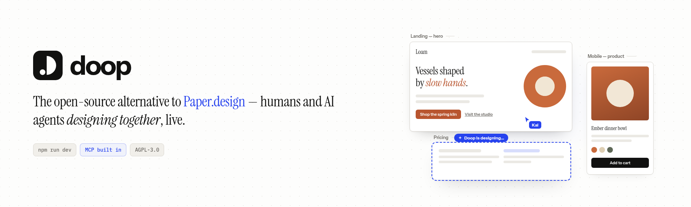
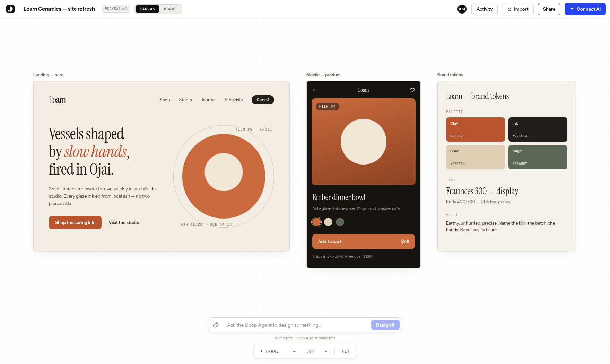
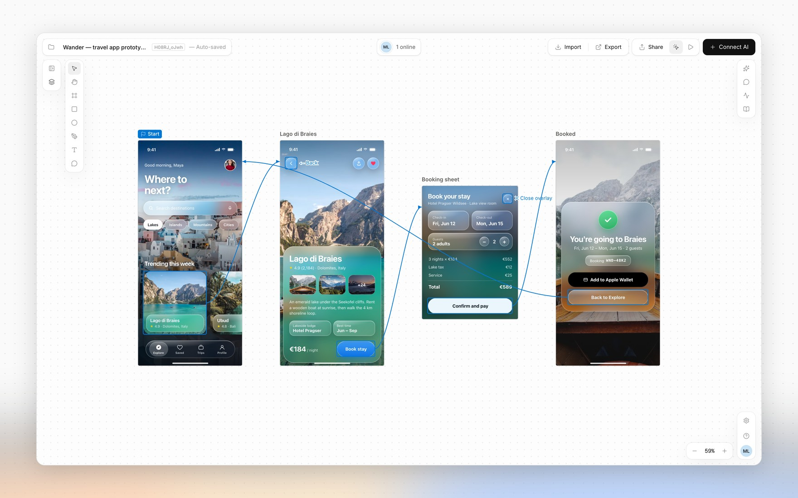
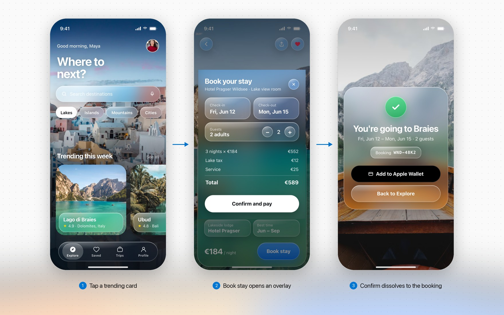
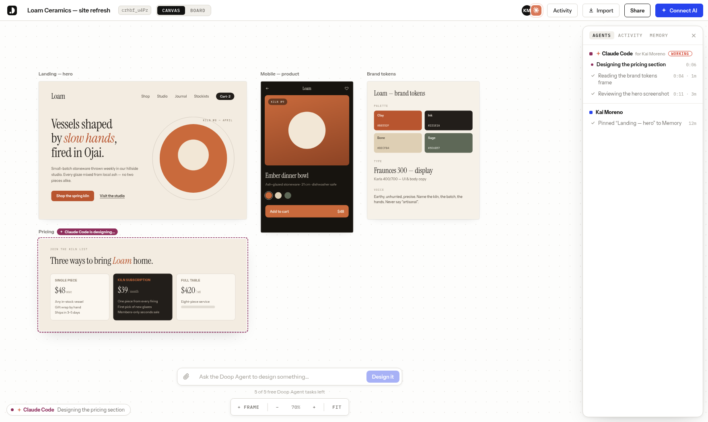
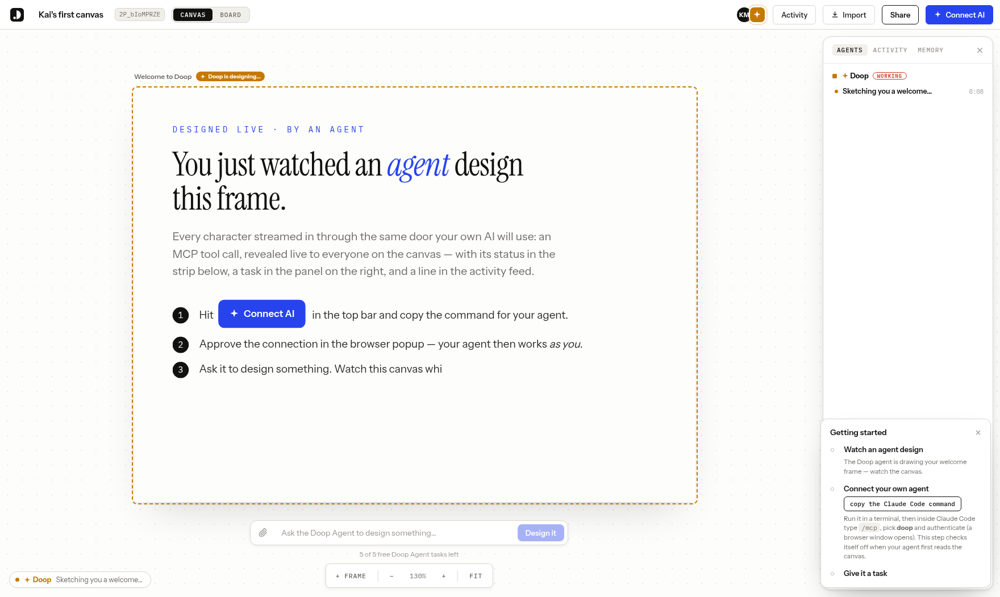
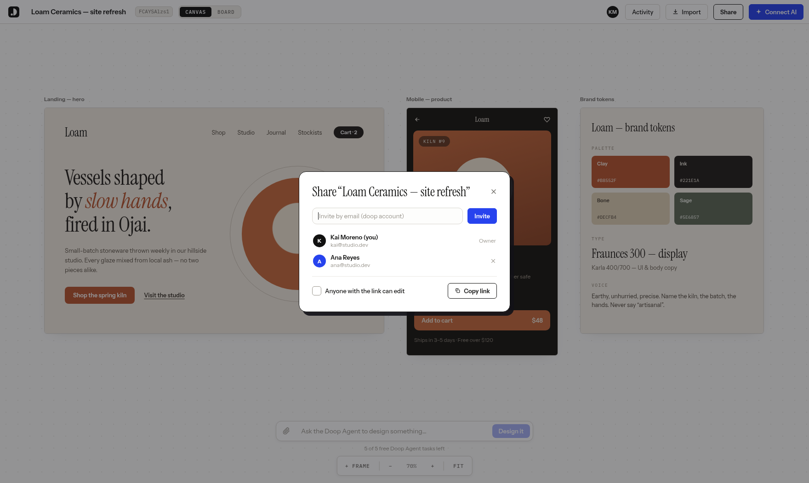

<p align="center">
  
</p>

<p align="center">
  <a href="https://github.com/kgoedecke/doop/actions/workflows/ci.yml"></a>
  <a href="LICENSE"></a>
  <a href="https://doop.design"></a>
  <a href="CONTRIBUTING.md"></a>
  <a href="https://discord.com/invite/3AUfXjgVe"></a>
</p>

**[Doop](https://doop.design/?utm_source=github) is the open-source alternative to [Paper.design](https://paper.design) — a multiplayer
design canvas for humans _and_ AI agents.** Every design lives on a shareable **Canvas**
(`/c/<id>`) holding **Frames** — artboards that render real HTML in sandboxed iframes. People edit
in the browser; AI agents edit through the built-in **MCP server**, streaming their designs in
live. Everyone sees everything as it happens: cursors, presence, frame edits, agent status, and an
activity feed.

Think of it as Claude Design for whichever agent you already use: **Claude Code, Codex, ChatGPT,
Cursor, OpenCode** or any other MCP client designs on the same canvas, and the built-in Doop Agent
runs on **GPT, Claude, Gemini, DeepSeek, Kimi or Qwen** models
([every agent and model](#works-with-any-agent)).

<p align="center">
  
</p>

- **Design with agents, not prompts-and-refresh** — connect Claude Code (or any MCP client) once,
  then watch it sketch, stream and self-review designs on your canvas, next to your cursor.
- **A built-in Doop Agent** — queue a card or @mention a role and it designs on its own, no client
  to connect. Runs on the server's `ANTHROPIC_API_KEY` for a handful of free tasks, then on the
  **ChatGPT subscription** (or OpenAI key) each user connects ([setup](#the-doop-agent)); the
  first-canvas welcome performance is scripted and runs without any of it.
- **Pages within a canvas** — organize frames into named pages from the Layers panel. Add, rename,
  drag to reorder, double-click to rename, or right-click to rename and delete empty pages.
  Page edits support Undo/Redo; selected frames can move between pages. Agents can list pages
  with `get_canvas`, manage them with `set_canvas_pages` (passing the original list as
  `expectedPages` to protect collaborators), and target frames with `pageId`.
- **Clickable prototypes** — wire elements to other frames (click, hover, press, key or delay;
  navigate, overlay, back, scroll or link, with transitions) in Prototype mode or straight in the
  HTML, then click through the flow with Play or share `/c/<id>/proto`. Agents use the same
  `data-doop-*` attributes plus `get_prototype` / `set_prototype_start`.
- **True multiplayer** — live cursors, presence, per-frame editing indicators, undo/redo, comments
  pinned to elements, and an activity feed, all over one WebSocket room.
- **Design memory** — pin exemplar frames, capture decisions, and let the distiller propose durable
  style rules that every agent follows.
- **Private by default** — invite collaborators by email or flip on link sharing per canvas;
  agents inherit exactly their human's access.
- **Self-host in one command** — `docker compose up`, or `bun run dev` with zero configuration
  (embedded Postgres, no external services required).

## Works with any agent

Doop isn't tied to one model vendor. Every agent below designs through the same MCP server, works
as the person who connected it, and shows up live on the canvas with its own cursor, status and
tasks. **Connect AI** in the top bar walks you through each one.

<p align="center">
  
</p>

| Agent                                        | How it connects                                                                 |
| -------------------------------------------- | ------------------------------------------------------------------------------- |
| Claude Code                                  | `claude mcp add`, OAuth in the browser ([setup](#hook-up-claude-code))          |
| Claude (web and desktop)                     | **Add to Claude** in Connect AI ([setup](#connect-claude))                      |
| Codex (CLI and desktop)                      | `codex mcp add`, OAuth in the browser ([setup](#connect-an-ai-agent))           |
| ChatGPT                                      | A custom MCP server in ChatGPT, guided by **Connect AI → ChatGPT**              |
| Cursor                                       | **Add to Cursor** in Connect AI                                                 |
| OpenCode, VS Code Copilot, OpenClaw and more | Any MCP client, over OAuth or with an agent key ([setup](#connect-an-ai-agent)) |
| Headless agents (n8n, Mastra, CI)            | An agent key as a bearer header ([setup](#headless-agents-agent-keys))          |

No agent of your own? The built-in [Doop Agent](#the-doop-agent) runs on the model account you
connect: a ChatGPT subscription, or an OpenAI, Claude, Gemini or OpenRouter key. OpenRouter brings
DeepSeek, Kimi, Qwen, GLM and MiniMax ([details](#past-the-free-tasks-connect-your-own-chatgpt)).

## Quickstart

```bash
git clone https://github.com/kgoedecke/doop && cd doop
bun install
bun run dev
```

Doop builds and installs with [bun](https://bun.sh) (`bun.lock` is the only
lockfile); the server itself runs on Node.

- Web app: **http://localhost:4300**
- API + WebSocket + MCP server: **http://localhost:4400** (the web port proxies `/api`, `/ws`, `/mcp` to it)

Everything works with no configuration: data persists to an embedded Postgres (PGlite) in `data/pg`,
and every optional integration (SMTP, stock photos, object storage, analytics) degrades gracefully
until its variable in [.env.example](.env.example) is set. The one you will most likely want is
`ANTHROPIC_API_KEY`, which turns on the built-in [Doop Agent](#the-doop-agent) — agents you connect
yourself over MCP need no key.

Or self-host the production build with Docker:

```bash
BETTER_AUTH_SECRET=$(openssl rand -hex 32) docker compose up -d   # app + Postgres on :4400
```

Production build without Docker: `bun run build && bun run start` (single server on :4400 serving
everything). Set `DATABASE_URL` to use a real Postgres — same code path as PGlite.

Prefer not to run anything? **[doop.design](https://doop.design)** is the hosted version.

Once you sign in, Home is where you start: describe what you want and Doop makes a canvas with
drafts queued for the Doop Agent, or pick up one of your canvases, workspaces and connected agents.

<p align="center">
  
</p>

## Canvas chat, imports and exports

The canvas Chat tab keeps a shared conversation alongside the design. Mention an agent role to
queue a design card; its reply threads back into the chat.

The import source picker offers **Website**, **Live app** (the sync snippet), and **GitHub repo**.
Right-click a frame and choose **Export…** to download PNG, JPG or a vector PDF (of the frame, or of
every selected frame as one PDF). **Export** in the top bar binds any frames of the page into one PDF. A progress toast tracks the
render; the desktop app opens its native save panel.

## Integrations

**Integrations** in the rail is where an account connects the outside tools Doop works with:

| Integration | What it does                                                                                                                               |
| ----------- | ------------------------------------------------------------------------------------------------------------------------------------------ |
| Linear      | Read issues through MCP, or delegate an issue to Doop: it designs a canvas and reports the result back to Linear ([setup](docs/linear.md)) |
| Slack       | Mention `@Doop` with a brief; it designs a canvas and posts the result in the thread ([setup](docs/slack.md))                              |
| Meta Ads    | Pull ad creatives onto a canvas on a schedule with an [automation](#automations)                                                           |
| Figma       | Import frames as editable HTML and export frames back to Figma. Doop Cloud only                                                            |
| Canva       | Import Canva designs as editable frames and send frames back with live text. Doop Cloud only                                               |

<p align="center">
  
</p>

To reference a specific element in feedback, select it and choose **Copy link**
in its floating toolbar, or right-click its Layers row and choose **Copy link to
element**. Opening the link selects the element and opens its properties on the
correct page. The URL includes the canvas ID, frame ID and URL-encoded CSS
`selector`, so an AI agent can locate it in the frame HTML. Canvas access rules
still apply. Selectors that use element IDs survive layout changes; selectors
based on sibling positions can change when the HTML is restructured.

## Approve screens for development

Select a frame and turn on **Development → Mark as approved** in the inspector,
or right-click one or more frames and choose **Mark ready for dev**. A green badge
appears above the screen and in Layers. Hover the toggle row or a badge to see
who approved it and when. Turn the toggle off to move an approved screen back to draft.

Changing the HTML or frame dimensions switches an approved screen to **Needs review**;
review it and turn **Mark as approved** on again. Moving, renaming, hiding, locking, or moving
between pages keeps approval. Copies start as drafts. An approval checks the frame
revision so a concurrent edit cannot accidentally be approved, and waits for live
design streams to finish.

Agents can read `approvalStatus` (`draft`, `ready_for_dev`, `needs_review`) and
`approval` attribution in `get_canvas` and `get_frame`. Call
`get_canvas({ canvas_id, approval_status: "ready_for_dev" })` to find approved
screens, then re-read `get_frame` before implementing. Only `ready_for_dev` is
current sign-off. Approval is set by people in the app. In **Automations**, choose
**Designs are approved** to run a workflow when frames on a selected canvas become
ready for dev. Without an enabled workflow, approval only records sign-off.

The REST equivalent is `PUT /api/frames/:id/approval` with
`{ status: "ready_for_dev" | "draft", expectedUpdatedAt }`. The signed-in user's
identity supplies the attribution; the endpoint uses the same canvas access rules
as editing and returns `409` when the reviewed revision is stale.

## Clickable prototypes

Turn frames into a flow you can click through. Switch on **Prototype mode** (top bar), pick an
element and add an interaction in its **Prototype** tab, or drag the handle on its right edge
onto another frame. Each interaction is a trigger (click, hover, press, a key or a delay) and an
action (go to a frame, open one as an overlay, go back, close the overlay, scroll, open a link),
with an optional transition: dissolve, slide or push. Connectors on the canvas show where every
element leads, and a **Start** flag marks the frame each page's flow begins on.

<p align="center">
  
</p>

Press **Play** to run it full screen, or share `/c/<canvas-id>/proto`: the player follows the
same canvas access rules, and the browser's Back and Forward walk the flow. Frames stay live
while you play, so an edit on the canvas shows up on the screen you are looking at.

<p align="center">
  
</p>

Interactions are plain attributes on the element in the frame HTML, so they sync, version and
export with the frame, and agents write them with the same tools they design with:

```html
<button data-doop-on="click" data-doop-action="navigate:<frameId>" data-doop-transition="push-left">Book stay</button>
```

Agents check their wiring with `get_prototype`, which flags links to missing frames, and set
the start with `set_prototype_start`. Both the MCP server and the built-in Doop Agent have them.
The full attribute reference is in [`.context/specs/prototyping.md`](.context/specs/prototyping.md).

## iPhone and iPad app

The SwiftUI iOS app lives in [`ios/`](ios/README.md). Open `ios/Doop.xcodeproj`
in Xcode to run it against Doop Cloud or your own HTTPS server. It uses SwiftUI for the app interface and a native canvas that
renders frames with the Blitz HTML/CSS engine (Rust, no WebKit), over the same REST API and WebSocket rooms. The app is in development;
see the iOS README for validation status and remaining release requirements.

## Connect Claude

Choose **Connect AI → Claude → Add to Claude**. On hosted Doop, this opens Claude's
connector form with Doop's name and server URL filled in. Confirm it, sign in to
Doop, then start a new Claude chat and paste the canvas prompt from the dialog.
No file download, terminal or API key needed.

The updated Doop desktop app also offers **Add to Claude** for local and self-hosted
servers: it opens Claude Desktop's extension installer directly, with your server
URL filled in. Confirm the installation in Claude and approve the Doop sign-in.
The online connector needs a publicly reachable HTTPS server; localhost connections
use the desktop app. Manual extension installation remains available as a fallback.
Build and installation details: [`claude-extension/`](claude-extension/README.md).

## Hook up Claude Code

One command connects Claude Code (or any MCP client) to your canvas:

```bash
claude mcp add --transport http doop http://localhost:4300/mcp
```

That triggers the standard MCP OAuth flow — a browser window opens, you approve, and from then on
the agent works **as you**. Ask it to design something on your canvas id and watch it happen live.
Everything in this shot is the real flow: Claude Code announced itself with `set_status`, created a
frame, and is streaming the pricing section in — presence avatar, "for Kai Moreno" attribution,
the frame chip, the working strip, and the task in the Agents panel.

<p align="center">
  
</p>

## Watch an agent design

The first canvas after signup comes with a performance: the Doop Agent streams a welcome
design in while you watch — status in the working strip, a task in the panel, a pulsing border on
the frame it's building.

<p align="center">
  
</p>

That welcome performance is **scripted** (`server/demo.ts`) — a pre-authored frame replayed through
the same machinery real agents use, so it runs with no configuration at all. The Doop Agent proper
needs a key.

## The Doop Agent

Doop ships a built-in design team that lives in the server and picks work up on its own: queue a
board card, `@mention` a role on an element comment, or leave feedback on a task, and it runs
without a human in the loop. Roles (Doop builds; specialists own one pass each — UX, copy, brand,
accessibility) are defined in [`shared/agents.ts`](shared/agents.ts), and a card can be routed
through several in order.

The server pays for the free tier, on Anthropic by default:

```bash
ANTHROPIC_API_KEY=sk-ant-...   # in .env, or the environment of your deployment
```

Same key gates the **guideline distiller** ([`server/distill.ts`](server/distill.ts)), which proposes
durable style rules from your canvas.

The free tier can run on **Azure OpenAI** instead — useful when your organisation's credits or
compliance rules live there:

```bash
DOOP_AGENT_PROVIDER=azure
AZURE_OPENAI_ENDPOINT=https://my-resource.openai.azure.com
AZURE_OPENAI_API_KEY=...
AZURE_OPENAI_DEPLOYMENT=my-deployment
```

The distiller stays on `ANTHROPIC_API_KEY` either way and quietly turns off without it.

### Past the free tasks: connect your own ChatGPT

When a user's `RESIDENT_TASK_LIMIT` free tasks are gone, they don't lose the agent — they connect a
model account and the Doop Agent keeps running on it. **A connected account takes over immediately**,
from the very next task: the free tier is a trial that gets people here, not a balance to spend down
first, and connecting stops costing the server anything from that moment. The connection is
account-level, so it lives at **/settings** (Home → Settings); the free-tier wall links there rather
than carrying its own copy, and "Connect an AI agent" on a canvas stays about MCP clients only. Six
kinds of account:

- **ChatGPT subscription** — OAuth against `auth.openai.com`, then inference through the Codex
  backend that Plus/Pro/Business plans include. Tokens live in `model_accounts` and never reach a
  browser.
- **OpenAI API key** — pay-as-you-go on the user's own OpenAI account, no subscription involved.
- **OpenRouter API key** — one key for a curated multi-vendor roster: Kimi, Qwen, GLM, DeepSeek,
  MiniMax, MiMo and Gemini Flash (the menu lives in
  [`shared/modelMenu.ts`](shared/modelMenu.ts)). Models without image input still work, in a
  degraded mode: the agent skips screenshot review, verifies through the frame HTML instead, and
  the picker labels them "no visual review".
- **Gemini API key** — Google's Gemini models through their OpenAI-compatible endpoint, plus Nano
  Banana image generation.
- **Gemini cloud pilot** — an operator-managed prototype running the official Gemini CLI in an
  isolated worker using Google sign-in. Disabled by default; see the
  [pilot setup and verification guide](docs/gemini-cloud-pilot.md).
- **Claude API key** — pay-as-you-go on the user's own Anthropic account.

The OpenAI, Claude and Gemini key kinds get their model menu from the provider's own catalog,
asked with that key when the picker opens (`server/modelCatalog.ts`,
`GET /api/model-account/models`): OpenAI's and Anthropic's `/v1/models`, Gemini's
`/v1beta/models`. A newly released model is on the menu without an upgrade; the curated entries
above sit on top as recommendations, a curated tier the key cannot run is left off, and the
curated menu alone is served if the provider cannot be reached. OpenRouter stays on its curated
roster, whose hand-checked vision flags are what the run relies on.

Azure OpenAI is deliberately _not_ a connectable account kind, and the OpenRouter/Gemini endpoints
are fixed constants: a user-supplied endpoint would be a URL the server fetches with the run's full
context — an SSRF vector — so custom endpoints stay server-level configuration only.

Either way the user picks their **model tier** in Settings from that provider's curated menu — on
OpenAI, `gpt-6-astra` (the newest flagship; on a ChatGPT subscription it needs Plus or better and
OpenAI is still rolling it out per account), `gpt-5.6-sol` (flagship), `gpt-5.6-terra` (the default
workhorse) or `gpt-5.6-luna` (cheap and fast). They are paying for it, so the choice is theirs;
`DOOP_AGENT_OPENAI_MODEL`, `DOOP_AGENT_OPENROUTER_MODEL` and `DOOP_AGENT_GEMINI_MODEL` only set the
default they start on. Note that
`gpt-5.4` and `gpt-5.4-mini` retire from ChatGPT-authenticated Codex on **31 August 2026**, so
pinning a 5.4 id via that env var will break the subscription path after that date.

OpenAI registers no redirect URI for a hosted app, so connecting ChatGPT takes one of three shapes
and Doop picks the cheapest one available:

| Where Doop runs                              | Flow                                         | What the user does                                            |
| -------------------------------------------- | -------------------------------------------- | ------------------------------------------------------------- |
| Same machine as the browser (dev, self-host) | Loopback catch — Doop holds `127.0.0.1:1455` | Approve in the OpenAI tab. Nothing to copy, no setup          |
| Hosted (doop.design)                         | Device code (`/api/accounts/deviceauth/*`)   | Type a short code at `auth.openai.com/codex/device`           |
| Device codes disallowed                      | Browser redirect + paste                     | Paste the dead `localhost:1455` page's address back into Doop |

The device flow needs **device code authorization** switched on in ChatGPT → Settings → Security
(workspace members need an admin to allow it) — that is why the loopback flow, which needs no
setting at all, stays the default when Doop is local. All three end at the same server-side PKCE
exchange.

> **Before you turn this on for real users:** driving a ChatGPT subscription from a third-party
> server is not something OpenAI's terms sanction, and heavy use can get an account rate-limited or
> suspended. The API-key path is the fully supported alternative and shares all the same code.
> `CHATGPT_CONNECT_DISABLED=1` switches the subscription path off and leaves the key path.

Runs are attributed to the human whose card, comment or feedback they picked up, so the person who
asked for the work is the person whose account runs it. The translation between the agent's
Anthropic-shaped loop and OpenAI's Responses API lives in
[`server/openaiAgent.ts`](server/openaiAgent.ts); which credential a run gets is decided in
[`server/agentModel.ts`](server/agentModel.ts).

**With no server key and no connected account** the Doop Agent is off, and it fails quietly by
design — queued cards and `@mentions` simply wait for some agent to claim them. The startup banner
tells you which state you're in.

**All of this is separate from connecting your own agent.** Claude Code and any other MCP client
authenticate over OAuth and drive the canvas from outside, on your own subscription — never metered.
Three paths, same canvas: the Doop Agent on our key (free tier), the Doop Agent on your key, or your
own agent over MCP.

| Variable                        | Default                     | What it does                                                                         |
| ------------------------------- | --------------------------- | ------------------------------------------------------------------------------------ |
| `DOOP_AGENT_PROVIDER`           | `anthropic`                 | What the free tier runs on: `anthropic` \| `azure`                                   |
| `ANTHROPIC_API_KEY`             | _unset_                     | Pays for the free Doop Agent tier (default provider) and the distiller               |
| `AZURE_OPENAI_ENDPOINT`         | _unset_                     | The free tier's Azure OpenAI resource, when `DOOP_AGENT_PROVIDER=azure`              |
| `AZURE_OPENAI_API_KEY`          | _unset_                     | A key of that resource                                                               |
| `AZURE_OPENAI_DEPLOYMENT`       | _unset_                     | The deployment the free tier runs on                                                 |
| `AZURE_OPENAI_API_VERSION`      | _unset_                     | Pins an `api-version` query parameter; the v1 surface needs none                     |
| `AZURE_OPENAI_REASONING_EFFORT` | _unset_                     | Reasoning effort on Azure runs; unset sends none (non-reasoning-safe)                |
| `RESIDENT_TASK_LIMIT`           | `0`                         | Free Doop Agent tasks per account; `0` means a connected account from the first task |
| `DOOP_AGENT_MODEL`              | `claude-opus-5`             | Model for the Doop Agent on the server's Anthropic key                               |
| `DOOP_AGENT_OPENAI_MODEL`       | `gpt-5.6-terra`             | Default tier on a user's account; each user can pick another in Settings             |
| `DOOP_AGENT_OPENROUTER_MODEL`   | `moonshotai/kimi-k2.6`      | Default model on a connected OpenRouter key                                          |
| `DOOP_AGENT_GEMINI_MODEL`       | `gemini-3.7-flash`          | Default model on a connected Gemini key                                              |
| `CHATGPT_CONNECT_DISABLED`      | _unset_                     | `1` hides the ChatGPT flow, leaving the API-key path                                 |
| `DOOP_DISTILL_MODEL`            | `claude-haiku-4-5-20251001` | Model for the guideline distiller                                                    |

`RESIDENT_TASK_LIMIT` is the free-tier meter. By default it is `0`: the Doop Agent only runs once
the user connects a model account (their ChatGPT subscription or an OpenAI key) — a connected
account is never metered. Connecting your own MCP agent does not lift the meter: it runs on your
model when _it_ designs, but resident tasks still bill a credential. Set the limit above 0 to
grant that many free tasks on the server's key; everything that triggers resident work counts,
including feedback and retries. There is no "unlimited" value: self-hosting with your own key, set
it to a large number, since you're paying Anthropic directly either way.

## Accounts

The web app requires an account (better-auth, email/password — open signup). Your account
name is your identity everywhere: cursors, presence, the activity feed, and feedback
attribution are all server-authoritative from the session, and the WebSocket rejects
unauthenticated joins. **Canvases are private by default**, Figma-style: only the owner
and people they invite (Share → invite by email, existing doop accounts) can open one.
The Share modal can also turn on link sharing per canvas ("anyone with the link can
edit"), which restores drop-a-link collaboration for that canvas. Your home screen lists
your own canvases plus ones shared with you (plus unowned legacy ones, claimable there).
Agents connected over MCP act under the account that approved them and get exactly that
user's access.

<p align="center">
  
</p>

With SMTP configured (`SMTP_HOST` etc. — see [.env.example](.env.example)), signups require email
verification and "forgot password" sends real reset links. Without it, signup stays open and every
email is printed to the server log, links included — the flows still work in development.

Set `SIGNUP_EMAIL_DOMAINS=jointhetroops.com` to restrict new accounts to one email domain, or use a
comma-separated list for several domains. Matching is case-insensitive and exact; existing accounts
are unaffected. Leave it unset to keep public signup open.

Set `REQUIRE_EMAIL_VERIFICATION=false` to let people in before they verify — the link is still
emailed, it just stops gating sign-in. Admin promotion is deliberately not part of that trade:
`ADMIN_EMAILS` only ever promotes a verified address (see below).

If signup or password reset **hangs** rather than failing, the cause is almost always a host that
blocks outbound SMTP: Railway and most PaaS block 25/465/587. Resend also serves 2465/2587, so
`SMTP_PORT=2587` is the usual fix.

Env: `BETTER_AUTH_SECRET` (required in production), `TRUSTED_ORIGINS` (comma-separated,
defaults to the localhost dev origins).

### Workspaces and billing (Team plan)

A **workspace** is a team's shared home for canvases: everyone in it opens every canvas inside,
with no per-canvas invites. Create one from the sidebar on the home screen, invite people by
email (existing accounts join at once; anyone else joins the moment they sign up with that
address), file canvases in it from the Share modal or the canvas menu ("Move to workspace…"),
and manage people, roles (owner / admin / member) and billing at `/w/<id>`. Agents see workspace
canvases in `list_canvases` and can create into one with `create_canvas`'s `workspace_id`.

Workspaces are the paid part of doop on a hosted deployment. Plans (see `shared/billing.ts`):

| Plan       | Price                                     | What it is                                                         |
| ---------- | ----------------------------------------- | ------------------------------------------------------------------ |
| Personal   | free                                      | Your own canvases, per-canvas invites, agents, community, imports. |
| Team       | $20 / seat / month, or $192 / seat / year | Shared workspaces with roles; seats follow the people list.        |
| Enterprise | talk to us                                | SSO, dedicated support, custom terms.                              |

**Self-hosting: billing is off unless you turn it on.** Without `STRIPE_SECRET_KEY` every
workspace is active and nothing is locked. With it, a workspace must hold a live per-seat
subscription before it can _grow_ — create canvases in it, invite people, take canvases in —
and the upgrade modal appears wherever that is attempted. Canvases already in a workspace stay
open to its members whatever the subscription does (a failed card never locks a team out of its
work). Deleting a workspace hands every canvas back to its owner's personal space and cancels
the subscription.

To enable billing: create the product and prices with `node scripts/stripe-setup.mjs`
(prints `STRIPE_PRICE_TEAM_MONTHLY` / `STRIPE_PRICE_TEAM_YEARLY`), point a Stripe webhook at
`<origin>/stripe/webhook` for `checkout.session.completed` and
`customer.subscription.{created,updated,deleted}`, and set `STRIPE_WEBHOOK_SECRET`. Checkout,
cards, invoices and cancelling all happen on Stripe's hosted pages; the server only mirrors the
subscription onto the workspace (through the webhook, and a direct sync when the browser lands
back from Checkout, so local development works without a tunnel).

### Instance admins

`ADMIN_EMAILS` (comma-separated) names the accounts that get the `admin` role, applied at
signup, on email verification, and at boot — so you can name an admin before or after they
have an account. **This requires SMTP in production**: an address only identifies someone
once they have proven they own it, and without a mailer signup is open, so anyone could sign
up as your address and take the role with it. A production instance without SMTP promotes
nobody and warns at boot; set the role directly in the database if that is your setup.
Admins get `/admin`: every canvas and account on the instance, and "view as", which hands
them a real but **read-only** 15-minute session as that user. Being an admin does not widen
canvas access itself: the gate in [`server/access.ts`](server/access.ts) is shared with MCP,
so a privileged read there would give every agent holding an admin's token the run of the
instance. View-as sessions cannot write, cannot connect agents, and record who is behind
them in `session.impersonated_by`.

### SSO (OIDC)

Optional login against an external OIDC provider (Zitadel, Okta, Authentik, Keycloak,
etc.), alongside email/password — not a replacement for it. Set `OIDC_ISSUER`,
`OIDC_CLIENT_ID`, and `OIDC_CLIENT_SECRET` together to enable it; a partial set refuses
to boot rather than run with SSO half-configured. `OIDC_SCOPES` (default
`openid email profile`) and `OIDC_PROVIDER_NAME` (default `SSO`, shown on the login
button — e.g. `Zitadel`) are optional. Signing in via SSO links to an existing
email/password account when the emails match and the provider marks the email
verified, and this works even on an instance with no SMTP configured, where a
local account could otherwise never verify on its own. SSO alone never grants
the admin role, even for an address listed in `ADMIN_EMAILS` — an IdP is not
trusted as an admin-promotion source, only as an email-ownership check;
promotion still requires the normal `ADMIN_EMAILS` path (verified signup, or
`syncAdmins` at boot for an account SSO has since verified).

Env: see the OIDC block in [.env.example](.env.example).

### Sign in with Google

Optional, alongside email/password and SSO. Create an OAuth client (Web application) in
the [Google Cloud console](https://console.cloud.google.com/apis/credentials), add
`<BETTER_AUTH_URL>/api/auth/callback/google` as an authorised redirect URI, and set
`GOOGLE_CLIENT_ID` and `GOOGLE_CLIENT_SECRET` together (one without the other refuses to
boot). The login page shows a "Sign in with Google" button whenever both are set. Account
linking and admin promotion follow the same rules as SSO above; `SIGNUP_EMAIL_DOMAINS`
applies to Google (and SSO) sign-ups exactly as it does to email/password.

### Sign in with Microsoft

Same shape as Google. Register an app in [Microsoft Entra](https://entra.microsoft.com)
(App registrations, platform Web) with `<BETTER_AUTH_URL>/api/auth/callback/microsoft` as a
redirect URI, create a client secret, and set `MICROSOFT_CLIENT_ID` and
`MICROSOFT_CLIENT_SECRET` together. `MICROSOFT_TENANT_ID` (default `common`, any Microsoft
account) can be `organizations`, `consumers`, or your tenant id to make the button an
org-only door. Microsoft does not assert email ownership unless the app registration's
ID token includes the `email` and `verified_primary_email` optional claims; without them a
Microsoft sign-in still works but only links to an existing account that is already
verified. Everything else (allowlist, admin promotion) follows the SSO rules above.

### Sign in with Apple

Two independent halves, documented in [.env.example](.env.example). For the web button,
register a Services ID with Sign in with Apple enabled and
`<BETTER_AUTH_URL>/api/auth/callback/apple` as a return URL, then set `APPLE_CLIENT_ID` (the
Services ID) and `APPLE_CLIENT_SECRET` (the client-secret JWT signed with your Sign in with
Apple key, which Apple caps at six months) together. For the iOS app, set
`APPLE_APP_BUNDLE_IDENTIFIER` to the app's bundle id: the app shows the native Sign in with
Apple button and posts the identity token Apple issues for that bundle id to
`/api/auth/sign-in/social`, which the server verifies against Apple's keys. Apple only sends
the person's name on their first sign-in, so the app forwards it then; a later sign-in from a
fresh install leaves the name as stored. Linking and admin promotion follow the SSO rules
above. Apple's "Hide My Email" addresses are on `privaterelay.appleid.com`, which
`SIGNUP_EMAIL_DOMAINS` rejects unless listed.

## Agent auth (MCP OAuth)

The `/mcp` endpoint requires OAuth. Adding the server in Claude Code / Codex triggers
the standard MCP OAuth flow: a browser window opens, you sign in to Doop and approve,
and the client stores a bearer token. Every tool call then carries your identity —
agent tasks show "for ⟨you⟩" in the Tasks panel, and presence tooltips name the owner.
Unauthenticated calls get a 401 with `WWW-Authenticate` discovery pointers
(`/.well-known/oauth-authorization-server` + `oauth-protected-resource`), which is what
kicks off the flow. Dynamic client registration is enabled, so no manual client setup.

In production also set `BETTER_AUTH_URL` to the public origin — OAuth URLs are built on it.

## Deploy

The repo ships a production `Dockerfile` (client build + Chromium for frame screenshots).
Any container host works; Railway/Fly are the least friction:

1. Create the app from this repo (both auto-detect the Dockerfile).
2. Add a managed Postgres and set `DATABASE_URL`. **Don't skip this in real deployments** —
   the PGlite fallback is embedded/single-process and only suits a single instance with a
   persistent volume mounted at `/app/data`.
3. Set `BETTER_AUTH_SECRET` (long random string) and `BETTER_AUTH_URL` (the public origin,
   e.g. `https://doop.example.com`). Extra allowed origins: `TRUSTED_ORIGINS` (comma-separated).
4. Health check: `GET /healthz`. The server trusts one proxy hop (`trust proxy`), so
   TLS termination at the platform edge works out of the box.

Local sanity check of the exact production image:

```bash
docker build -t doop .
docker run -p 4400:4400 -e BETTER_AUTH_URL=http://localhost:4400 -e BETTER_AUTH_SECRET=dev-only doop
```

## Connect an AI agent

The MCP endpoint (streamable HTTP, stateless) is at:

```
http://localhost:4300/mcp
```

Claude Code:

```bash
claude mcp add --transport http doop http://localhost:4300/mcp
```

Codex:

```bash
codex mcp add doop --url http://localhost:4300/mcp
```

Generic MCP config:

```json
{ "mcpServers": { "doop": { "type": "http", "url": "http://localhost:4300/mcp" } } }
```

OpenCode takes Doop as a remote MCP server in `opencode.json`. An
[agent key](#headless-agents-agent-keys) in the header skips the browser sign-in:

```json
{
  "$schema": "https://opencode.ai/config.json",
  "mcp": {
    "doop": {
      "type": "remote",
      "url": "http://localhost:4300/mcp",
      "headers": { "Authorization": "Bearer dpk_…" }
    }
  }
}
```

### Headless agents (agent keys)

The OAuth flow above assumes a human at a browser to approve the connection. A headless client — a
Mastra workflow, n8n, CI, any server-side agent framework — authenticates with an **agent key**
instead: mint one under **Settings → Agent keys** and send it as a bearer header. The key acts as
your account (same canvas access, same attribution) and is checked on every request, so revoking it
in Settings cuts the agent off immediately.

```json
{
  "mcpServers": {
    "doop": {
      "type": "http",
      "url": "http://localhost:4300/mcp",
      "headers": { "Authorization": "Bearer dpk_…" }
    }
  }
}
```

Then tell the agent something like:

> Work on canvas `<canvas-id>` (shown in the top bar). Call `get_canvas` to see the existing frames.
> To design, create a frame with `create_frame`, then stream the design into it with `append_frame_html`
> in ~300–500 character chunks (`start=true` on the first, `done=true` on the last) so people watch it
> build up live. Complete HTML with inline CSS. After finishing, call `get_frame_screenshot` to see it,
> fix what looks wrong, and re-check. Pick an `agent_name` and reuse it on every call.

Screenshots render in your system Chrome/Chromium via `puppeteer-core` (set `CHROME_PATH` if it isn't
auto-detected). Humans can hit the same renderer at `GET /api/frames/:id/screenshot.png?scale=2`.
For website viewing/imports, setting `CONTEXT_DEV_API_KEY` makes Context.dev acquire the rendered
HTML while Doop still sanitizes it and renders the preview locally; without the key, Doop navigates
to the public page directly in Chromium.

### Design sync: push an app's live screens onto a canvas

Server-side import can't reach apps behind SSO or a VPN. The **doop-sync snippet** flips the capture
to the user's browser: mint a write-only key in a canvas's Share dialog, drop one tag into the app —

```html
<script async src="https://your-doop-origin/doop-sync.js?key=dk_…"></script>
```

— and every distinct screen people visit lands on that canvas as a frame (one row per app), imported
once: a short grace window lets the first capture settle (scroll reveals, late images), then the frame
freezes so later visits — different viewports, other users' data, open menus — never churn it. Deleting
a frame re-imports it on the next visit; navigation counts keep accumulating regardless. Routes are
normalized (`/orders/8231` → `/orders/:id`) so each screen maps to one
frame; captures are serialized from the CSSOM (so styled-components/emotion output survives), and
same-origin webfonts and small images are inlined as data: URIs — fonts require CORS inside the
sandboxed frame, and intranet URLs would never render for viewers outside the network. Scripts are
stripped client- and server-side, input values are always dropped, and anything marked `data-doop-mask`
is redacted before upload (`data-doop-sync-ignore` excludes an element entirely). The key is the whole
credential: it can only write frames to its one canvas, so revoking it in the Share dialog cuts the
app off instantly. Endpoint: `POST /ingest/<key>` (CORS-open, no cookies).

### How streaming looks (server-side smoothing)

Agent HTML lands in the store immediately, but viewers see it through a **typewriter reveal**: the server
broadcasts the accumulated HTML at a steady rate (~500 chars/s, accelerating to clear backlogs in ~8s),
so even an agent that sends few large chunks — or a one-shot `set_frame_html` / `create_frame` with
full HTML — plays back as a smooth live stream. Mid-reveal HTML is _healed_ before broadcast: a trailing
half-written tag is dropped, an unclosed `<script>` is cut (never run half-written JS), and an unclosed
`<style>` is closed so content paints instead of blanking. Human edits from the inspector bypass the
reveal (and a human html edit cancels any open reveal — the human takes over).

While a stream/reveal is open the frame gets a pulsing dashed border and a "✦ <agent> is designing…"
chip; "finished designing" logs when the reveal completes. A stale stream auto-closes after 30s.
There is also a REST equivalent: `POST /api/frames/:id/append` with `{ html_chunk, start?, done?, actor? }`.

### How agents learn the workflow

Steering happens at three layers (the same architecture paper.design uses, plus result nudges):

1. **Server `instructions`** at MCP initialize — a compact contract: load the guide, get context
   first, stream designs, review with screenshots, keep one `agent_name`.
2. **`get_guide` tool** — the deep playbook (mandatory review checkpoints, streaming workflow,
   frame sizing, design-quality doctrine, multiplayer etiquette), loaded once per session and
   re-loadable after context compaction. Source: `server/guide.ts`.
3. **Result nudges** — `create_frame` / `set_frame_html` / final `append_frame_html` results tell
   the agent it hasn't _seen_ its design yet and to call `get_frame_screenshot` before moving on.

### MCP tools

| Tool                   | What it does                                                                                                                                                           |
| ---------------------- | ---------------------------------------------------------------------------------------------------------------------------------------------------------------------- |
| `get_guide`            | The agent playbook — agents are instructed to load this first                                                                                                          |
| `set_status`           | Broadcast a one-line "what I'm working on" — shown live in the working-now strip, avatar tooltip, and activity feed                                                    |
| `get_feedback`         | Fetch & claim open human feedback requests — for agents whose job is to poll the canvas periodically                                                                   |
| `get_comments`         | Read element-pinned comments and replies, optionally filtered by frame or resolution state, without claiming work                                                      |
| `reply_to_comment`     | Reply inside an element-comment thread; `@mention` of a resident role is metered like a browser comment                                                                |
| `resolve_comment`      | Resolve an element-comment thread; resolving an `@mention` thread records the exchange in canvas Memory                                                                |
| `list_canvases`        | List all canvases                                                                                                                                                      |
| `create_canvas`        | Create a canvas, returns its shareable id                                                                                                                              |
| `get_canvas`           | Canvas layout: every frame's position/size/meta                                                                                                                        |
| `view_website`         | Inspect one public page read-only; returns a desktop screenshot and visible text without changing the canvas                                                           |
| `import_webpage`       | Import one public URL onto a canvas as an editable HTML snapshot/frame                                                                                                 |
| `create_frame`         | Add a frame with HTML (auto-placed if no x/y)                                                                                                                          |
| `get_frame`            | Read a frame including its HTML                                                                                                                                        |
| `get_frame_screenshot` | Render the frame headlessly and return a PNG — lets agents _see_ and iterate on their design                                                                           |
| `set_frame_html`       | Replace a frame's design in one shot — renders live for everyone                                                                                                       |
| `append_frame_html`    | **Stream** a design in chunks (`start=true` first, `done=true` last) — viewers watch it build up                                                                       |
| `edit_frame_html`      | Targeted exact find/replace in a frame's HTML — morphs into the render in place                                                                                        |
| `update_frame`         | Rename / move / resize a frame                                                                                                                                         |
| `delete_frame`         | Remove a frame                                                                                                                                                         |
| `generate_image`       | Generate an image from a prompt with the image model picked in Settings (GPT Image, Nano Banana or Seedream), on the user's own account, else a server key → asset URL |

Mutating tools accept `agent_name`; the agent then appears in the presence stack (pulsing square avatar),
gets an "editing" ring + chip on the frame it touched, and its actions land in the activity feed. Agents
expire from presence after ~20s of inactivity (~60s while they have a posted status, since a status
usually means the agent is thinking between tool calls).

Agent-to-human ownership comes from the OAuth token: the bearer token identifies who approved
the connection, and that user shows up as the agent's owner in tasks and presence.

### Live task narration

Agents are steered (instructions + guide) to call `set_status` with a one-line, present-tense summary
when they start a task and whenever their focus shifts — e.g. _"Sketching a mobile onboarding flow"_.
Statuses appear in a floating **working-now strip** at the bottom-left of the canvas (pulsing dot in the
agent's color), in the presence avatar tooltip, and as an activity feed entry, so you always know what
each agent is doing even while it's silently thinking. An empty string clears the status; it also
expires with the agent's presence.

Every status also becomes a **task**: posting a new status completes the previous one, clearing (or
going silent) ends the open task. Agents that never call `set_status` still show up: the server
infers a task from what they visibly do (_"Designing 'Hero'"_, italicized in the panel), closes it
when the stream finishes, and nudges them in tool results to start announcing — so the panel works
even for sessions that connected before the tool existed or skipped the guide. The side panel is split into two tabs — **Tasks** shows the history
per agent (active task pulsing with a running duration, finished ones checked off with how long they
took), Cursor-agent-panel style; **Activity** is the raw event feed. Task history survives agents
leaving and is sent to late joiners.

### Steering agents: feedback on tasks

Hover any task in the Tasks tab and hit **↩** to leave feedback (e.g. _"make the accent warmer"_).
Each note becomes an **open request on the canvas** — a work item, not mail for the agent whose
task it was. MCP is pull-based, so delivery rides the result-nudge layer: the **next identified
agent call** on the canvas that supports feedback delivery (carrying an `agent_name`, whoever it is) returns a
`HUMAN FEEDBACK` block quoting the note, saying whose work it concerns, and instructing the agent
to address it before continuing — including editing another agent's frame (a human request
overrides the don't-touch etiquette). Picking it up claims it: the UI flips from _"→ waiting for
an agent…"_ to _"✓ picked up by ⟨agent⟩"_, and each note is claimed exactly once.

Agents don't linger waiting for replies — sessions end when their work ends. Open requests simply
wait for the next agent to show up: the original agent in a later session, a different agent
already on the canvas, or a fresh one you spawn (_"check in on canvas ⟨id⟩"_). For a dedicated
caretaker, point an agent at `get_feedback` — a non-blocking fetch-and-claim designed for a
"check the canvas every few minutes, address whatever humans requested" loop.
REST equivalent: `POST /api/tasks/:id/feedback` with `{ text, from }`.

### Element comments through MCP

Call `get_comments({ canvas_id })` to read the canvas's retained element comments and replies
(up to 100 entries, newest first). Each entry includes its ID, frame ID, author, text, timestamp,
CSS selector, HTML snippet, and any claim, failure, or resolution metadata. Replies carry a
`parentId` pointing to their root comment.

Pass `frame_id` to read only comments on a frame belonging to that canvas, or
`include_resolved: false` to exclude resolved entries. Resolved entries are included by default
so conversation context remains available. An empty result is `[]`. The tool enforces the same
canvas access permissions as other MCP reads; optional `agent_name` announces presence.
It does not claim task feedback or comments, or mark anything resolved.

`reply_to_comment({ canvas_id, comment_id, text, agent_name })` adds a reply to a thread,
inheriting the root's element anchor. `resolve_comment({ canvas_id, comment_id, agent_name })`
closes it, and resolving an `@mention` thread also records the exchange in canvas Memory. Both
require the same canvas access as every other MCP tool. A reply whose text `@mentions` a resident
role spends one resident task from the account's allowance — the same free-tier meter that a board
card, an `@mention` comment, or task feedback consumes (`server/allowance.ts`); plain replies are
free. `resolve_comment` also costs nothing.

## Automations

An automation runs on a schedule (daily, weekdays or weekly, in any time zone) or
when designs on a selected canvas are approved. Configure up to six steps at `/automations`.
Approval presets make different sizes, localize designs, or create companion assets;
edit the brief to choose dimensions, languages and deliverables. Generated designs start as drafts.

- **Pull steps** land designs on a canvas: **Meta ad creatives** (up to 200 ads, each with its image,
  name, copy and CTA; `META_APP_ID`/`_SECRET`, read-only `ads_read` scope).
- **Agent steps** queue a board card for one Doop Agent role, identical to a card a person writes,
  and billed to the automation's owner. Following steps wait until that card completes.
- **Create Linear ticket** uses the owner's connected Linear account and selected team.
  The connection needs permission to create issues.
- **Post to Slack** uses the owner's Slack installation and a channel ID. Invite @Doop
  to the destination channel. Both handoff actions include source design links and links
  produced by earlier steps.

Schedules are checked every minute; approvals and ongoing work every five seconds. One run
per automation is active at a time. Up to ten approvals are grouped into each run, with each
approval processed once, including after a restart or run-history cleanup. Enabling a workflow
watches future approvals; **Run now** also picks up existing, unprocessed approvals.
Changing an approved source to draft or needs review stops its remaining workflow steps.
Agent work times out after one hour. Sizes, languages, and asset briefs are editable presets.

Every run has a summary or an actionable error. Interrupted external calls fail visibly instead
of automatically repeating a possibly successful ticket or message. Check the destination before
reapproving a design to start another run. Approval receipts are retained until the automation is
deleted; completed run history is limited to 100 entries. Existing scheduled automations retain
their schedules and now wait for agent completion between steps.

Types live in [`shared/automations.ts`](shared/automations.ts), the runner in
[`server/automations.ts`](server/automations.ts).

## What's in the box

- **Infinite canvas** — wheel to pan, `⌘`/`ctrl` + wheel (or pinch) to zoom, drag the background to pan,
  zoom-to-fit; dot grid tracks the viewport.
- **Frames** — drag to move, corner handle to resize, click to select. The right-hand inspector edits
  name/position/size and the raw HTML with debounced live saves. `⌫` deletes the selected frame.
- **Multiplayer** — live cursors with name tags, presence avatars, per-frame "who's editing" indicators,
  colored flash when a remote actor changes a frame, drag positions streamed live, auto-reconnect.
- **Activity feed** — every create/edit/rename/delete, by whom (user or agent), with timestamps.
- **Sharing** — the canvas URL is the share link (`Share` button copies it).
- **Connect AI modal** — copy-paste MCP setup instructions from the app itself.

## Architecture

```
server/          Node (tsx) — one process on :4400
  index.ts       Express REST API + ws rooms + presence + static serving (prod)
  store.ts       In-memory canvas/frame state (hot path), write-through to the DB
  db/            Drizzle schema + PGlite/Postgres connection + write-through persistence
  actions.ts     Shared mutations: broadcast + activity log + agent presence
  mcp.ts         MCP server (@modelcontextprotocol/sdk), stateless streamable HTTP at /mcp
  seed.ts        Demo canvas on first run
shared/types.ts  Store + ws protocol types shared by server and client
src/             React + Vite + zustand client on :4300
  components/ui/ The component system — every styled primitive lives here
  styles.css     Design tokens, the base reset, and keyframes. Nothing else.
```

### Styling

Doop's look is a component system, not a stylesheet. `src/components/ui/` holds the
primitives — `Button`, `Input`, `Badge`, `Card`, `Panel`, `Modal`, `Menu`, `Toolbar`,
`Segmented`, `Dash*` and the rest — each a Tailwind + [CVA](https://cva.style) recipe bound
to the tokens in `styles.css`. Screens compose those; they don't re-describe borders,
shadows or type scales. If a pattern shows up twice, it belongs in `ui/`.

`src/styles.css` is deliberately small: the `:root` tokens (`--ink`, `--paper`, `--brand`…),
their `@theme inline` mapping onto Tailwind names, the base reset, and the `@keyframes`
utilities cannot express. Components reference those animations by name, so the names are
API. `--breakpoint-md` (900px) is the mobile boundary and `useIsMobile()` matches it in JS —
change them together.

Frame HTML renders in `<iframe sandbox="allow-scripts">` — scripts run, but no same-origin access and
no reach into the app. Each iframe loads a small bootstrap once; new HTML is `postMessage`d in and
**DOM-morphed in place** (`src/lib/frameRuntime.ts`), so updates and streaming ticks never white-flash
the frame with a full document reload. Changed `<script>`s re-execute; unchanged styles/fonts are
untouched. The realtime layer is plain JSON over a per-canvas WebSocket room;
REST/MCP mutations are broadcast to the room by the shared actions layer, so human and agent edits go
through identical plumbing.

## Contributing

PRs welcome — see [CONTRIBUTING.md](CONTRIBUTING.md) for commit conventions and code style.
`bun run test` runs the integration suite (it boots the real server against a throwaway database);
schema changes go through drizzle migrations (`npx drizzle-kit generate` after editing
`server/db/schema.ts`). Security issues: see [SECURITY.md](SECURITY.md) — please report privately.

## License

Doop is open source under the [GNU AGPL v3](LICENSE). In short: use it, self-host it,
modify it — but if you offer a modified version as a service, you must publish your
changes under the same license.

The **doop name and logo are trademarks** and are not covered by the code license —
please rebrand derived services.
