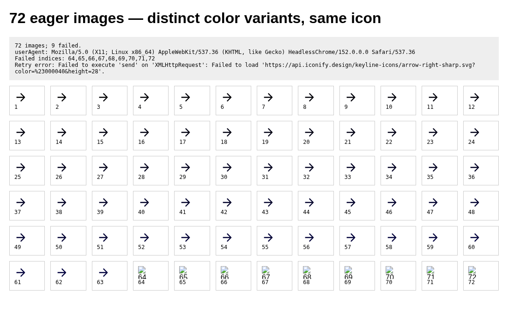
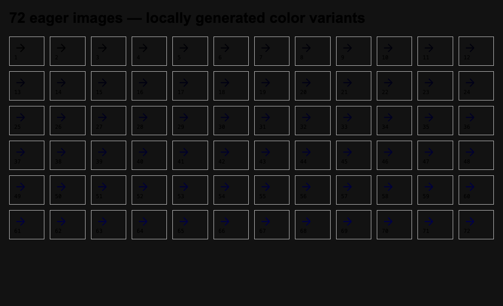
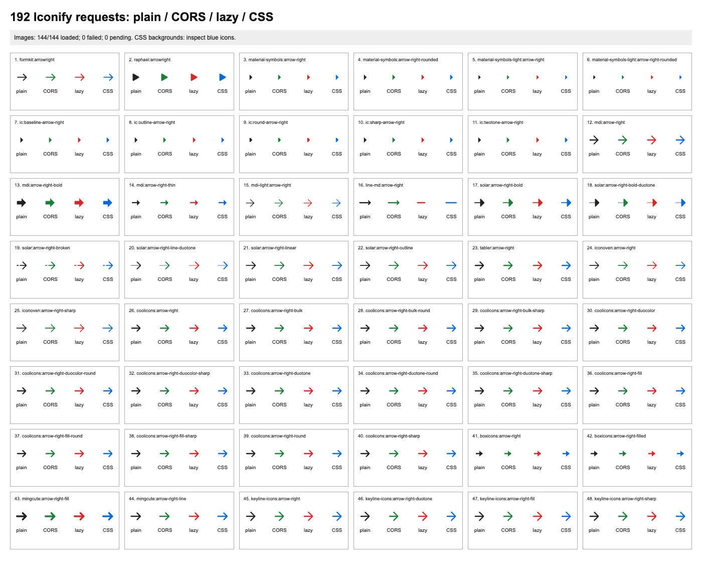

# Iconify screenshot reproduction

Observed November 10, 2026, 01:56–01:59 UTC against the hosted Doop MCP server,
before PR #474. These reproduce the reported symptom; Daniel's original frame
was not available for comparison.

## Hosted results

Test canvas: https://doop.design/c/4xhfxd4ZYd

All icon URLs came from `search_icons`. Each frame used direct external URLs;
none used the proposed Doop cache. Rendered with `get_frame_screenshot`, scale 1.

| Frame        | Input                                                                                 | Result                                                                                       |
| ------------ | ------------------------------------------------------------------------------------- | -------------------------------------------------------------------------------------------- |
| `sD4fC3G8go` | 24 home icons, plain and colored (48 images)                                          | All 48 visible                                                                               |
| `dlAZFCs4_r` | 48 arrow icons, each plain, CORS, lazy and CSS background (192 distinct URL variants) | Diagnostic script counted 64/144 images loaded and 80 failed; CSS backgrounds visibly absent |
| `k571jH1YzJ` | One arrow icon, 72 distinct color variants, ordinary eager images                     | Images 1–63 loaded; 64–72 failed                                                             |

The final frame uses `https://api.iconify.design/keyline-icons/arrow-right-sharp.svg`
with `?color=%23<hex>&height=28`, where `<hex>` runs from `000001` through `000048`.
It lays out 72 ordinary `` elements. On window load,
the diagnostic counts images with `naturalWidth === 0`. A synchronous XHR retry
of the first failed URL also failed, without exposing an HTTP status to the page.



## Local network evidence

The 192-request fixture was also rendered in local Chrome, first directly and then
through the unmodified `guardPublicPageRequests` implementation:

- Direct: 149 HTTP 200 responses and 43 `net::ERR_BLOCKED_BY_ORB` request failures;
  101/144 image elements loaded, 43 failed.
- Pinned fetch path immediately afterward: 144 HTTP 429 responses; all 144 image
  elements failed. These runs share an outbound IP, so the second run is not an
  independent comparison of the two implementations.
- A subsequent single SVG request confirmed the rate-limit response below.

```text
2026-11-10 01:59:44 UTC
HTTP/2 429
content-type: text/plain; charset=UTF-8
retry-after: 237
server: cloudflare

error code: 1015
```

Stopped burst requests after receiving this response. Do not run repeated load
tests against the public API without respecting its retry interval.

## What this establishes

Broken hotlinked icons are reproducible in the hosted screenshot tool, and icon
request bursts can trigger upstream rate limiting locally. The hosted failures
cluster near 64 requests, but the screenshot alone does not expose their network
status; do not claim an exact Iconify quota or confirmed hosted root cause from
that count.

## Revised implementation and validation

PR #474 now stores immutable base icon data by icon id, shared across users, and
renders color/size variants locally. Cold misses are batched by collection with
at most two upstream requests active. HTTP 429 pauses uncached downloads for the
upstream `Retry-After` interval; stored icons remain available. Search results are
stored before their URLs are returned.

The renderer preloads static icon dependencies and supplies SVG bytes through a
request resolver before the trusted/direct-network bypass. This covers existing
Iconify hotlinks as well as Doop URLs. Inline SVG edits remain independent copies.
The resolver must stay ahead of the hosted renderer's `offNetwork` bypass when
this change is ported to that deployment.

Validated locally with the revised renderer and the real public Iconify API,
using an empty storage directory for each cold scenario:

| Fixture                                | Cold result                                                       | Upstream data requests  | Repeat JPEG export |
| -------------------------------------- | ----------------------------------------------------------------- | ----------------------- | ------------------ |
| 72 color variants of one icon          | 72 loaded, 0 failed, 0 pending                                    | 1                       | 0 Iconify requests |
| 48 icons in four forms (192 resources) | 144 image elements loaded, 0 failed, 0 pending; CSS icons visible | 15 (one per collection) | 0 Iconify requests |





Automated coverage uses mocked upstream data to verify cold batching, bounded
concurrency, persistent reuse after a store restart, shared backoff (including
queued work), copy isolation, and invalid input handling. Browser tests verify
PNG/JPEG pixels and offline warm PDF export. A separate request-guard test checks
that cached icon responses run before the direct-network bypass.

These are local results. The hosted deployment has not been changed or retested
with this implementation; its screenshots above show the original failure.
